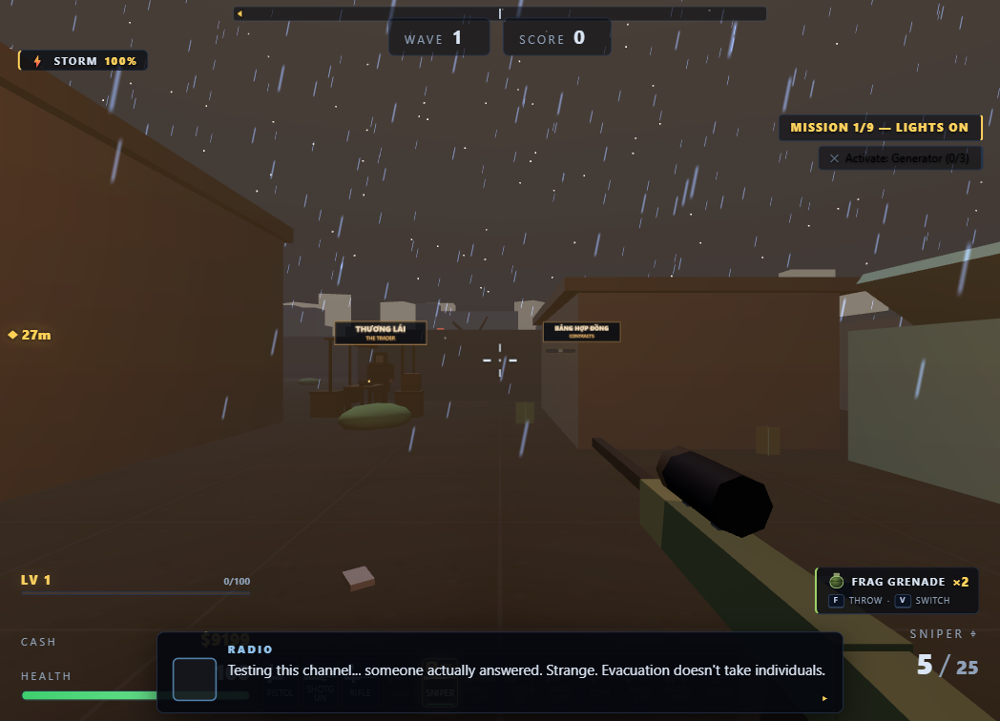
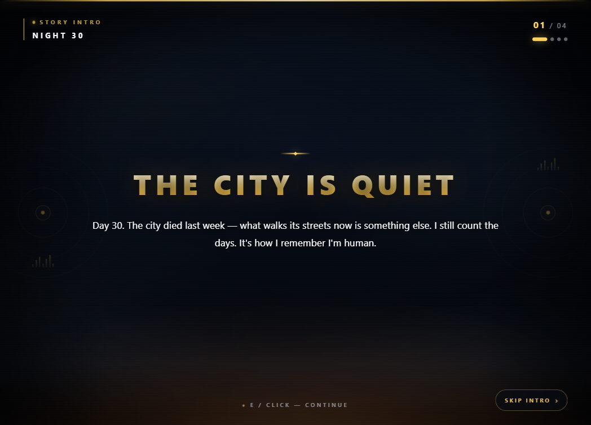
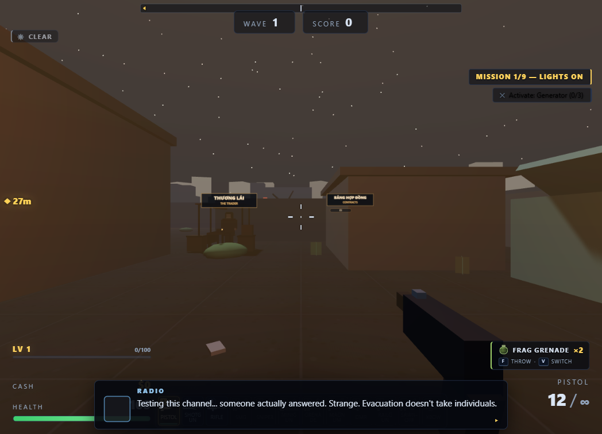
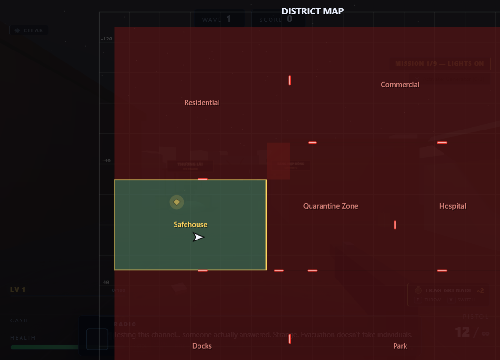
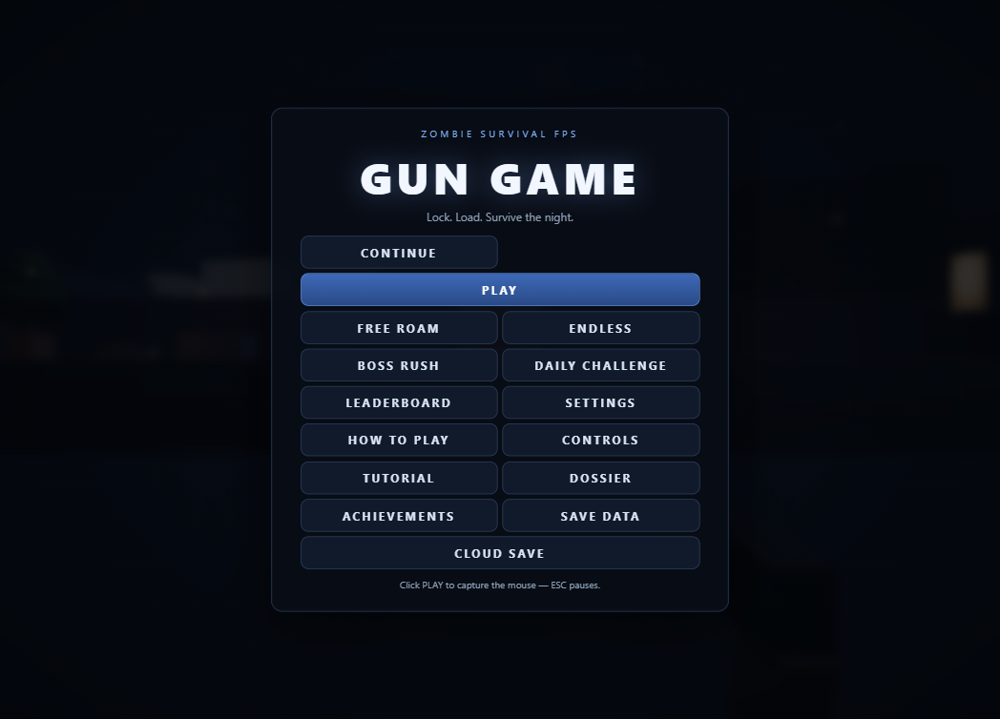
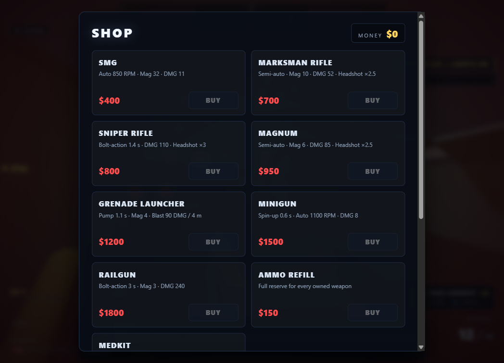
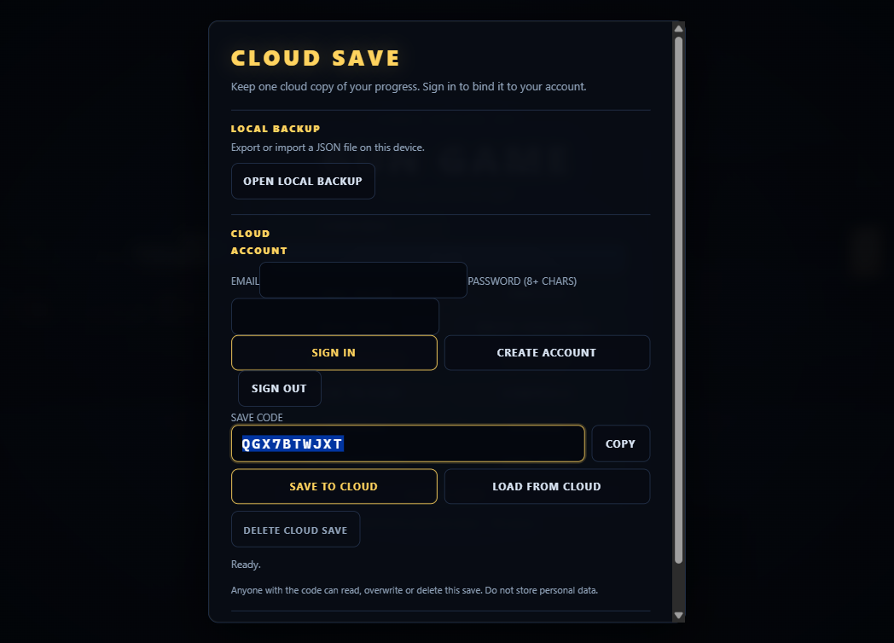

# Gun Game

> *Thành phố đã tắt đèn từ lâu. Chỉ còn bạn, một khẩu súng lục và những con quái vật biết đường về khu cách ly. Qua từng quận phong tỏa — từ sân trường bỏ hoang đến bệnh viện tối đen — bạn lần theo dấu vết của Nguồn, thứ đã biến cả thành phố thành nghĩa địa. Mở từng cánh cổng, cứu từng người sống sót, và kết liễu con quái vật cuối cùng trước khi bình minh kịp lên.*

**Gun Game** là game bắn súng góc nhìn thứ nhất (FPS) sinh tồn zombie chạy ngay trên trình duyệt — **thế giới 7 khu quận**, **12 khẩu súng**, **thương lái**, **bom ném**, **XP + 12 kỹ năng**, **hợp đồng phụ**, **thời tiết động ảnh hưởng gameplay**, **động vật hoang dã**, **trại người sống sót**, **barel nổ dây chuyền** — cộng thêm **Boss Rush 5 boss**, **phụ tùng súng**, **hai đồng đội Mai & Eli**, **sét bão**, **chế độ ảnh**, **sao lưu JSON**, **vòng vũ khí 12 ô**, **bảng xếp hạng**, **thử thách hằng ngày** và **lưu đám mây theo tài khoản** (Neon Postgres) — viết bằng **Three.js + Vite** (ES modules thuần, không framework), tối ưu cho cả GPU tích hợp. Sống sót qua từng đợt wave ngày càng đông, săn headshot để ghi điểm và phá kỷ lục của chính mình.



| Mở đầu câu chuyện | Bão qua các quận | Bản đồ 7 quận phong tỏa |
|---|---|---|
|  |  |  |

| Menu chính | Cửa hàng vũ khí | Tài khoản & lưu đám mây |
|---|---|---|
|  |  |  |

**Mới chơi?** Đọc [hướng dẫn người chơi đầy đủ](docs/GUIDE.md) — hoặc bấm `H` ngay trong game để mở sổ tay ba tab ĐIỀU KHIỂN · ZOMBIE · HỒ SƠ.

## Cách chạy

Cần Node.js đã cài sẵn trên máy.

```bash
# 1. Cài phụ thuộc
npm install

# 2. Chạy máy dev (cổng mặc định 5173)
npm run dev
```

Mở **http://localhost:5173** trong trình duyệt (vì cấu hình `host: true`, máy khác trong LAN cũng truy cập được qua IP của bạn).

Hoặc chạy bản build production:

```bash
npm run build     # xuất bản build vào dist/
npm run preview   # phục vụ dist/ tại http://localhost:4173
```

## Điều khiển

| Phím / thao tác | Hành động |
|---|---|
| `W` `A` `S` `D` | Di chuyển |
| `Shift` (trái/phải) | Chạy nhanh (×1.6 tốc độ đi bộ) |
| `Space` | Nhảy |
| Chuột | Ngắm (pointer lock) |
| Chuột trái | Bắn |
| `R` | Nạp đạn |
| `E` | **Tương tác** — kích hoạt máy phát điện / đống lửa trại, nhặt vật phẩm nhiệm vụ (gói tiếp tế, hộp thuốc, can xăng); nhắc **"E — TƯƠNG TÁC"** hiện khi đứng gần điểm tương tác |
| Giữ `Q` | **Vòng vũ khí 12 ô** — xoay bằng hướng chuột / con lăn / phím số, thả `Q` để xác nhận, `Esc` để hủy (game tạm dừng khi vòng mở) |
| `1` `2` `3` hoặc con lăn chuột | Đổi súng khởi đầu: `1` pistol · `2` shotgun · `3` rifle |
| `4` `5` `6` `7` `8` `9` `0` | Đổi sang súng mua trong cửa hàng: `4` SMG · `5` Sniper · `6` Minigun · `7` Grenade Launcher · `8` Magnum · `9` DMR · `0` Railgun (đổi súng chỉ luân chuyển trong các súng **đã sở hữu**) |
| `-` `=` | Súng **độc quyền của thương nhân** (không bán trong cửa hàng `B`): `-` Sawn-off · `=` Crossbow (chỉ dùng được sau khi mua) |
| `F` | **Ném bom / đặt mìn** đang chọn (lựu đạn mảnh · molotov · mìn cận chiến) |
| `V` | **Đổi bom** đang chọn (bỏ qua loại đã hết; túi rỗng vẫn xoay vòng để HUD hiện loại kế tiếp) |
| `G` | **Giao dịch với Thương Lái** — đứng trong **4.5 m** quanh quầy ở An Toàn Nhà; ngoài tầm thì hiện gợi ý "tìm Thương Lái" |
| `T` | **Bảng hợp đồng** — đứng trong **3.5 m** quanh bảng ở An Toàn Nhà; game tạm dừng khi bảng mở |
| `B` | Mở / đóng **CỬA HÀNG** (game tạm dừng khi cửa hàng mở; `Esc`/`B` để đóng) |
| `M` | Mở / đóng **BẢN ĐỒ** — overlay 7 khu toàn thành phố (chỉ khi đang chơi; cửa hàng mở thì phím im lặng) |
| `H` | Mở / đóng **SỔ TAY** — 3 tab ĐIỀU KHIỂN (CONTROLS) · ZOMBIE (ZOMBIES) · HỒ SƠ (DOSSIER); mở giữa trận thì game **không tạm dừng**, `H`/`Esc` để đóng (im lặng khi cửa hàng đang mở) |
| `Esc` (hoặc `P`) | Tạm dừng / tiếp tục |
| `F2` | Mở / đóng **CHẾ ĐỘ ẢNH** — chỉ khi đang chơi; game tạm dừng, HUD ẩn |
| `F4` | Trong chế độ ảnh: lưu khung hình ra **PNG** |
| `F5` | **Xuất dữ liệu lưu** ra file JSON (hoạt động ở mọi trạng thái) |
| `F9` | **Nhập dữ liệu lưu** từ file JSON rồi tải lại trang |
| `F3` | Bật / tắt bộ đếm FPS ở góc phải trên (mặc định ẩn) |
| Menu chính → **HUẤN LUYỆN** | Chạy lại tutorial 9 bước bất cứ lúc nào, không xoá tiến trình |

Nút **ĐẤU BOSS**, **THỬ THÁCH NGÀY**, **BẢNG XẾP HẠNG**, **DỮ LIỆU LƯU** và **LƯU ĐÁM MÂY** nằm ở menu chính — xem bảng dưới.

## Menu chính — 15 nút

| # | Nút | Hành động |
|---:|---|---|
| 1 | **TIẾP TỤC** | Chỉ hiện khi có save hợp lệ; khôi phục tiền, súng + nâng cấp + phụ tùng, nhiệm vụ, cổng, điểm |
| 2 | **CHƠI** | Cốt truyện: intro điện ảnh 4 slide → nhiệm vụ 1 |
| 3 | **CHƠI TỰ DO** | Bỏ intro, vào thẳng thế giới, nhiệm vụ 1 active |
| 4 | **SINH TỒN** | Sinh tồn vô tận ở Vùng Cách Ly, không có chuỗi nhiệm vụ |
| 5 | **ĐẤU BOSS** | **Boss Rush**: chuỗi 5 boss ở Vùng Cách Ly, không đụng save cốt truyện |
| 6 | **THỬ THÁCH NGÀY** | **Daily Challenge**: Boss Rush với modifier cố định theo ngày + thời tiết ép buộc |
| 7 | **BẢNG XẾP HẠNG** | Top 10 Boss Rush local, hai tab **TẤT CẢ / HẰNG NGÀY** |
| 8 | **CÀI ĐẶT** | Độ nhạy, âm lượng, EN/VI, độ khó, trợ năng |
| 9 | **HƯỚNG DẪN** | Sổ tay ba tab (như phím `H`) |
| 10 | **ĐIỀU KHIỂN** | Mở thẳng tab ĐIỀU KHIỂN của sổ tay |
| 11 | **HUẤN LUYỆN** | Chạy lại tutorial 9 bước |
| 12 | **HỒ SƠ** | Mở thẳng tab HỒ SƠ (dossier) của sổ tay |
| 13 | **THÀNH TỰU** | 12 thành tựu + thống kê trọn đời |
| 14 | **DỮ LIỆU LƯU** | Xuất / nhập toàn bộ tiến trình bằng JSON cục bộ |
| 15 | **LƯU ĐÁM MÂY** | Sao lưu / khôi phục bằng mã 10 ký tự qua Vercel Blob — nút rộng full hàng |

Menu chính dùng **lưới 2 cột**: **CHƠI** (primary) và **LƯU ĐÁM MÂY** (`btn-wide`) trải full cả hai cột; 13 nút còn lại xếp hai cột. Dưới **520 px** ngang, lưới tự về **1 cột**. Ở màn hình thấp **≤ 780 px** (720p), panel thu gọn padding, cỡ tiêu đề và khoảng cách nút để đủ **15 nút** mà không phải cuộn.

## Hướng dẫn trong game (phím `H`)

Sổ tay tra cứu mở bằng `H` (hoặc nút **HƯỚNG DẪN** ở menu chính / menu tạm dừng). Mở giữa trận thì game **không tạm dừng** — zombie vẫn tiến, nên chỉ mở khi đã nấp an toàn. `H` hoặc `Esc` đóng; `←` `→` `Home` `End` chuyển tab; cửa hàng đang mở thì `H` im lặng.

| Tab | Nội dung |
|---|---|
| **ĐIỀU KHIỂN (CONTROLS)** | Bảng phím đầy đủ (di chuyển / chiến đấu / thế giới) + 7 mẹo cơ bản — có cả `F` ném bom, `V` đổi bom, `G` Thương Lái, `T` hợp đồng |
| **ZOMBIE (ZOMBIES)** | **11 thẻ sinh vật**: 6 loại thường + 4 boss + Nguồn Gốc — HP, tốc độ, sát thương, điểm, đợt xuất hiện, đặc tính và cách chống; cuối tab là **4 biến thể tinh anh** (thẻ mini: màu, hệ số, thưởng) |
| **HỒ SƠ (DOSSIER)** | **10 nhân vật**, mỗi người **2 tầng** = **20 mục**: hồ sơ công khai + **hồ sơ ẩn**. Chưa mở thì hiện `???` kèm gợi ý cụ thể; mở được hồ sơ ẩn thì hồ sơ công khai cũng tự mở |

Tiến trình hồ sơ lưu vĩnh viễn trong `localStorage` (`gungame.codex.v1` + `gungame.codex.progress.v1`) và **không bị xoá khi chạy lượt mới**.

| Nhân vật | Hồ sơ công khai | Hồ sơ ẩn |
|---|---|---|
| Người Dẫn Đường | Bắt đầu cốt truyện | Hoàn thành nhiệm vụ 5 |
| Giọng Thì Thầm | Tới nhiệm vụ 3 | Tới nhiệm vụ 7 |
| Kỹ Thuật Viên Eli | Hoàn thành nhiệm vụ 1 | Hoàn thành nhiệm vụ 6 |
| Mai | Cứu 1 người sống sót | Cứu tổng cộng 3 người sống sót |
| Bác Sĩ Linh | Hoàn thành nhiệm vụ 4 | Hoàn thành nhiệm vụ 8 |
| Lão River | Hoàn thành nhiệm vụ 6 | Hoàn thành nhiệm vụ 9 |
| Đội Trưởng Vũ | Hạ bất kỳ boss nào | Hạ cả 4 boss thường |
| Vệ Binh | Hoàn thành nhiệm vụ 8 | Tới nhiệm vụ 10 |
| Kane — Đồ Tể | Hạ Đồ Tể | Hạ cả 4 boss thường |
| Nguồn Gốc | Tới nhiệm vụ 10 | Đánh bại Nguồn Gốc |

Chi tiết từng mục, bảng vũ khí, toàn bộ cốt truyện và kỹ thuật: [docs/GUIDE.md](docs/GUIDE.md).

## Mẹo sinh tồn

1. **Đạn là tiền tệ thứ hai.** Pistol có đạn dự trữ **vô hạn** — dùng nó cho walker lẻ và để dành đạn súng đắt cho runner, brute, boss.
2. **Headshot là lãi kép.** Mặc định ×2 sát thương, sniper ×3, magnum/DMR ×2.5 — vừa hạ nhanh hơn vừa được +50% tiền/điểm.
3. **Nhìn vòng sáng dưới chân để nhận diện tinh anh.** Frenzied lao rất nhanh, Ironhide rất trâu, Toxic nổ khi chết, Giant to và đấm đau; chúng trả tiền/điểm cao hơn hẳn nên đáng ưu tiên.
4. **Bloater và Toxic nổ khi chết.** Bloater: 25 dmg trong **4 m**; Toxic: 15 dmg trong **2.5 m**. Hạ từ xa, đừng đứng sát để nhặt xác.
5. **Boss luôn báo trước.** Đồ Tể đỏ lửa 0.8 s rồi lao thẳng — bước ngang. Kẻ Gào Thét hít hơi — lùi ra ngoài **8 m**. Người Đá giơ tay — rời vòng **8 m**. Nguồn Gốc phát sáng đỏ trước cú húc — né ngang.
6. **Tuyệt đối không đứng trong vũng acid.** Vũng xanh gây 6 dmg/s; mép vũng đã an toàn, nhưng đừng để bị dồn vào góc.
7. **Mua sắm giữa wave, không giữa trận.** `B` mở cửa hàng và **tạm dừng game**; tranh thủ 10 s nghỉ giữa wave để mua súng / nâng cấp / nạp đạn. `G` ghé Thương Lái ở An Toàn Nhà để mua súng độc quyền, bom và giáp.
8. **Nạp trước khi vào wave boss.** Tự nạp chỉ kích hoạt **0.35 s sau khi băng về 0**; đổi súng sẽ huỷ nó. Chủ động `R` khi còn 1–2 viên.
9. **Luôn giữ một lối thoát.** Đặt lưng vào tường hoặc cổng, không đứng giữa ba hướng zombie; hành lang và cổng hẹp là chỗ tốt để shotgun/minigun phát huy.
10. **Thứ tự ưu tiên mục tiêu:** Spitter/Screamer (gây áp lực từ xa) → Runner/Crawler (áp sát nhanh) → Bloater/Toxic (nổ diện rộng) → Brute/Armored (headshot) → boss.
11. **Bom để mở màn, không để cứu mạng.** Lựu đạn 3.6 m / 90 dmg và mìn 4 m / 120 dmg đều **không gây hại cho bạn**, nhưng molotov 2.6 m / 5 s chỉ đốt zombie — ném vào cổng trước khi bầy tràn vào.
12. **Chọn kỹ năng theo súng đang dùng.** Mỗi cấp cho **1 trong 3 thẻ** từ pool 12; cộng dồn không giới hạn, nên 3 stack Đạn Nặng (+36%) thường đáng hơn rải đều 6 thẻ.
13. **Hợp đồng là thu nhập phụ miễn phí.** Bảng ở An Toàn Nhà có 3 hợp đồng, tự trả tiền khi xong và xoay sau mỗi 3 đợt — nhận trước khi vào wave để tiện đếm tiến độ.

## Tính năng

- **12 loại súng** với cơ chế riêng — 3 súng khởi đầu, **7 súng mua trong cửa hàng** và **2 súng độc quyền của Thương Lái** (mua ngoài cửa hàng `B`). Nâng cấp sát thương / băng đạn / tốc độ nạp áp dụng cho **mọi súng đã sở hữu**, kể cả súng thương lái:

  | Súng | Nguồn / Giá | Cơ chế | Sát thương | Băng / dự trữ | Nạp | Headshot | Vai trò |
  |---|---|---|---|---|---|---|---|
  | Pistol | Khởi đầu · $0 | bán tự động, chặn spam 0.1 s | 25 | 12 / ∞ | 1.2 s | ×2 | Đạn vô hạn; dọn walker lẻ, tiết kiệm đạn đắt |
  | Shotgun | Khởi đầu · $0 | pump 0.9 s | 12 × 8 viên | 6 / 24 | 2.0 s | ×2 | Cận chiến; cứu nguy khi crawler/runner áp sát |
  | Rifle | Khởi đầu · $0 | auto 600 vòng/phút | 18 | 30 / 90 | 1.8 s | ×2 | All-rounder cho phần lớn trận |
  | SMG | Cửa hàng · $400 | auto 850 vòng/phút | 11 | 32 / 160 | 1.6 s | ×2 | Dồn đạn gần–trung, dự trữ rất nhiều |
  | Sniper | Cửa hàng · $800 | bolt 1.4 s | 110 | 5 / 25 | 2.4 s | **×3** | Mở màn boss, headshot elite/armored từ xa |
  | Minigun | Cửa hàng · $1500 | quay nòng 0.6 s rồi auto 1100 vòng/phút | 8 | 150 / 300 | 3.6 s | ×2 | Trụ boss/dọn bầy; quay nòng trước khi ló ra |
  | Grenade Launcher | Cửa hàng · $1200 | pump 1.1 s, đạn nổ | 90 tại tâm → 0 ở 4 m | 4 / 12 | 2.6 s | — | Dọn cụm ở cổng/hành lang; nổ khi chạm hoặc sau 1.2 s |
  | Magnum | Cửa hàng · $950 | bán tự động 0.35 s | 85 | 6 / 36 | 2.2 s | ×2.5 | Súng lục nặng, chính xác; headshot 212.5 |
  | DMR | Cửa hàng · $700 | bán tự động 0.22 s | 52 | 10 / 70 | 2.0 s | ×2.5 | Bắn tỉa nhịp nhanh, spread thấp; headshot 130 |
  | Railgun | Cửa hàng · $1800 | bolt 1.1 s | 240 | 3 / 12 | 3.0 s | ×2 | Một phát xoá brute/elite; headshot 480; spread 0 |
  | Sawn-off | **Thương Lái** · $650 | pump 0.55 s | 14 × 10 viên | 2 / 30 | 1.8 s | ×2 | Hai nòng cưa; cực mạnh ở cự ly sát, spread 0.09 |
  | Crossbow | **Thương Lái** · $750 | bolt 1.6 s | 150 | 1 / 24 | 1.7 s | **×3** | Nỏ im lặng, spread 0.001, không nháy nòng; headshot 450 |

  ID nội bộ: `pistol` · `shotgun` · `rifle` · `smg` · `sniper` · `minigun` · `grenade` · `magnum` · `dmr` · `railgun` · `sawnoff` · `crossbow`.
  Mọi súng đều có giật, độ tản đạn, thời gian nạp đạn và đèn nháy đầu nòng riêng (nỏ không có đèn). **Đổi súng draw 0.2 s** (trước 0.3 s) — không bắn được trong lúc draw; áp dụng cả khi chọn từ vòng `Q`.
- **Thương Lái "THƯƠNG LÁI"**: quầy cố định ở An Toàn Nhà, mở bằng `G` trong **4.5 m**; **4 tab**, **15 mặt hàng** (11 món gốc + **4 phụ tùng**), kho riêng mỗi lượt và **DEAL −25%** luân phiên sau mỗi 5 đợt sạch.
- **Bom ném**: `F` ném / đặt, `V` đổi loại; kit đầu **2 lựu đạn · 1 molotov · 0 mìn**; frag 3.6 m / 90 dmg, molotov 2.6 m / 5 s / 12 dmg mỗi giây, mìn 4 m / 120 dmg.
- **Boss Rush**: nút **ĐẤU BOSS** ở menu — 5 boss liên tiếp trong Vùng Cách Ly (**Đồ Tể → Phun Acid → Gào Thét → Người Đá → Nguồn Gốc**), mỗi lúc 1 boss, nghỉ 2.5 s, thưởng **$1000 → $3000**; panel kết quả có **BEST / RANK** và nút **XẾP HẠNG**.
- **Vòng vũ khí (giữ `Q`)**: 12 ô quanh vòng tròn đúng thứ tự `1`…`9`/`0`/`-`/`=`; xoay bằng hướng chuột, con lăn hoặc phím số, **thả `Q`** để xác nhận, **`Esc`** hủy và trả lại súng cũ. Game tạm dừng khi vòng mở; ô chưa mua bị khóa và hiện toast **ĐÃ KHÓA**.
- **Bảng xếp hạng + Thử thách ngày**: top 10 Boss Rush lưu local, sắp **điểm giảm dần / thời gian tăng dần**, hai tab **TẤT CẢ / HẰNG NGÀY**; mỗi ngày một modifier cố định (hardcore / storm / fog) kèm thời tiết ép buộc và **START** riêng.
- **Lưu đám mây**: nút **LƯU ĐÁM MÂY** ở menu (và nút **CLOUD** trong **DỮ LIỆU LƯU**) — sao lưu 7 key tiến trình. **Đăng nhập tài khoản** (email + mật khẩu, Neon Postgres) để bản lưu gắn riêng với tài khoản của bạn; chưa đăng nhập vẫn dùng được **mã 10 ký tự** kiểu cũ (ai có mã cũng đọc/ghi được — đừng lưu dữ liệu cá nhân).
- **Phụ tùng súng**: tab **PHỤ TÙNG** của Thương Lái — **kính ngắm $450 · băng mở rộng $400 · giảm thanh $500 · laser $350**, gắn vào **súng đang cầm**, tối đa 1 món mỗi súng, kho 2 món/lượt.
- **Mai & Eli — hai đồng đội**: cứu người sống sót lần 1 → **Mai** (pistol **25 dmg / 1.1 s / 20 m**); lần 2 → **Eli** (rifle **30 dmg / 1.4 s / 24 m**); lần 3 → cả hai lên tier 2 (**35 / 42 dmg**). Mỗi người **120 HP**, quỵ **12 s** rồi hồi sinh **50%**, không collider, chọn mục tiêu riêng.
- **Sét bão**: chỉ trong bão, sét đánh gần cách người chơi **8–30 m**, bán kính **3.2 m**, **160 dmg** sau 0.1 s — chỉ trúng zombie.
- **Chế độ ảnh + sao lưu**: `F2` freecam chụp ảnh (PNG bằng `F4`); `F5`/`F9` xuất/nhập **7 key tiến trình** thành một file JSON cục bộ; bản deploy có thêm lưu đám mây tùy chọn.
- **XP & 12 kỹ năng**: XP từ kill / nhiệm vụ / hợp đồng / qua đợt; tối đa **cấp 20**; mỗi cấp chọn **1 trong 3 thẻ** từ pool 12, cộng dồn vô hạn; game tạm dừng khi chọn.
- **Hợp đồng phụ**: bảng ở An Toàn Nhà, mở bằng `T` trong **3.5 m**; **3 hợp đồng** active xoay sau mỗi 3 đợt sạch, **8 loại**, tự trả tiền + XP.
- **Thế giới sống**: mưa / bão / sương mù theo chu kỳ — mưa giảm **10%** tốc zombie, bão **12%**, sương mù **5% + tầm nhìn thấp**; 12 quạ · 10 chuột · 3 chó hoang, 7 trại người sống sót tặng quà, 13 barel + 5 bình gas nổ dây chuyền.
- **Trợ năng**: FOV 60–110, rung màn hình 0–100, 4 màu tâm ngắm, cỡ tâm ngắm 0.75–1.5, số sát thương bật/tắt, giảm chuyển động — áp dụng ngay và lưu vào `localStorage`.
- **Thanh 12 ô vũ khí** ở đáy màn hình, đúng thứ tự phím `1`…`9`/`0`/`-`/`=`: ô đang cầm sáng vàng kèm `băng / dự trữ`, ô chưa mua bị mờ + ổ khoá, ô đang nạp có dấu riêng và vạch đạn màu theo lượng đạn còn lại. Giữ `Q` để mở **vòng vũ khí** cùng 12 ô đó.
- **Tutorial lần đầu**: 9 bước (di chuyển → chạy → bắn → nạp → đổi súng → nhảy → tương tác → cửa hàng → sổ tay), chỉ tiến khi bạn làm đúng và tự nhảy sau 20 s mỗi bước để không chặn game; lưu cờ `gungame.tutorial.v1`. Chạy lại bằng nút **HUẤN LUYỆN** ở menu.
- **Tự nạp đạn**: phát bắn làm băng đạn về 0 mà còn đạn dự trữ → **tự động nạp sau 0.35 s** (một lần; đổi súng sẽ hủy). Kéo cò khi hết băng mà còn dự trữ → **click khô + nạp ngay**. Hết cả băng lẫn dự trữ → chỉ khô đạn như cũ.
- **Tiền + cửa hàng**: hạ zombie được tiền (walker $50 · runner $75 · brute $200 · crawler $60 · bloater $300 · armored $350, **headshot +50%**; boss $700–$1500, Nguồn Gốc $2000 — bảng dưới). Nhấn `B` mở cửa hàng; tiền reset về 0 mỗi lần chạy mới.
- **6 loại zombie thường**: Walker (100 HP, 2.2 m/s, 15 dmg — chậm, lì, wave 1+), Runner (60 HP, 5.0 m/s, 10 dmg — lao nước rút, wave 2+), Brute (400 HP, 1.4 m/s, 35 dmg — bức tường thịt, wave 4+), Crawler (45 HP, 6.2 m/s, 8 dmg — bò lết nhanh nhất, tầm đánh 1.4 m, wave 3+; Sinh Tồn 2+), Bloater (260 HP, 1.15 m/s, 30 dmg — túi độc vỡ khi chết: 25 dmg / 4 m, wave 6+; Sinh Tồn 4+), Armored (320 HP, 1.7 m/s, 28 dmg — giáp chặn 35% sát thương vào thân, headshot xuyên giáp, wave 9+; Sinh Tồn 6+). Mỗi loại có model, màu da, tốc độ và cách chống riêng. Chết có 18% rơi vật phẩm — 70% hộp đạn (+1 băng đạn cho súng đang cầm), 30% blood bag (+40 HP, tối đa 100).
- **Biến thể TINH ANH**: zombie thường (không bao giờ boss) có thể hoá **Frenzied / Ironhide / Toxic / Giant** — vòng sáng màu dưới chân, mắt đổi màu. Story từ **wave 4**, Sinh Tồn từ **wave 3**; tỉ lệ mỗi con = `min(22%, 6% + wave×0.4%)`, **giảm nửa ở wave boss**, tối đa **25% quân số minion của wave**.
  - **Frenzied (Cuồng Loạn)** — tốc ×1.45, dmg ×1.15, HP ×0.9; tiền ×1.6, điểm ×1.3.
  - **Ironhide (Da Sắt)** — HP ×2.2, tốc ×0.92, dmg ×1.1; thân giảm thêm 20% (cộng với Armored → ×0.52), headshot xuyên cả hai; tiền ×1.8, điểm ×1.5.
  - **Toxic (Độc Tố)** — HP ×1.3, tốc ×1.05, dmg ×1.1; nổ khi chết **15 dmg / 2.5 m**; tiền ×1.5, điểm ×1.35.
  - **Giant (Khổng Lồ)** — cỡ ×1.45, HP ×1.8, dmg ×1.35, tốc ×0.9; tiền ×2.0, điểm ×1.6.
- **Khu vực + boss**: hai khu mới mở dần theo wave (bản đồ dưới); **mỗi wave chia hết 5 là BOSS WAVE** — lượng minion giảm nửa (dồn trong 6 s đầu) và một boss xuất hiện ở khu đã mở, luân phiên butcher → spitter → screamer → golem. Wave chỉ tính sạch khi cả boss lẫn minion (kể cả minion boss triệu hồi) đều gục.
- **Headshot**: bắn trúng đầu nhân sát thương theo từng súng (mặc định ×2, sniper ×3, magnum/DMR ×2.5) và nhân 1.5 điểm thưởng.
- **High score**: điểm cao nhất được lưu tự động vào `localStorage` (kèm thiết lập chuột, âm lượng, ngôn ngữ).
- **Nhạc nền thích ứng + nhịp tim**: drone/gió xuyên suốt, tiếng kim loại ngẫu nhiên 12–25 s, nhịp sub từ wave 2, arp từ wave 3, kèn boss crossfade 1.2 s; Trăng Máu đổi giọng + thump 50 BPM; **HP < 35** bật nhịp tim 60–90 BPM. Toàn bộ synth WebAudio, không file âm thanh; menu/pause giảm còn 25%, game over 15%.
- **Cảnh vật & cây cối**: 54 cây (46 sống + 8 chết) trồng cố định khắp 7 khu, thân có collider 0.7 m; mặt trăng + quầng sáng, vòng skyline 46 toà nhà, 12 cột đèn giả thể tích, 8 thùng lửa (6 đèn nhấp nháy), gạch đá / bao cát / xe bỏ hoang / rào chắn, vũng kim loại và 220 đốm đom đóm — gộp mesh, không cấp phát mỗi frame.
- **Hiệu ứng bắn**: tracer theo từng viên (tối đa 8 mỗi phát; sniper trắng xanh, railgun xanh điện), vỏ đạn đồng bay + rơi chạm sàn (1 vỏ mỗi phát đạn thường, sống 1.2 s), tia lửa + bụi khi trúng vật rắn, khói đầu nòng; tất cả dùng pool sẵn, không tạo object mỗi frame.
- **Song ngữ EN/VI**: đổi tiếng Anh / tiếng Việt ngay trong màn Settings (cùng với độ nhạy chuột 0.5–3.0 và âm lượng 0–1).

## Cửa hàng (phím `B`)

| Mặt hàng | Giá | Tác dụng |
|---|---|---|
| SMG (Tiểu liên SMG) | $400 | Súng mới — auto 850 vòng/phút, mag 32 |
| DMR (Súng Bắn Tỉa DMR) | $700 | Súng mới — bán tự động 0.22 s, 52 dmg, mag 10, headshot ×2.5 |
| Sniper (Súng bắn tỉa) | $800 | Súng mới — bolt 1.4 s, 110 dmg, headshot ×3 |
| Magnum (Súng Lục Magnum) | $950 | Súng mới — bán tự động 0.35 s, 85 dmg, mag 6, headshot ×2.5 |
| Grenade Launcher (Súng phóng lựu) | $1200 | Súng mới — pump 1.1 s, bắn đạn nổ (mag 4) |
| Minigun | $1500 | Súng mới — quay nòng 0.6 s, auto 1100 vòng/phút, mag 150 |
| Railgun (Súng Điện Từ) | $1800 | Súng mới — bolt 1.1 s, 240 dmg, mag 3, spread 0 |
| Nạp đạn (Ammo Refill) | $150 | Nạp **ĐẦY đạn dự trữ mọi súng đang sở hữu** (mua lại được nhiều lần) |
| Medkit (Túi cứu thương) | $200 | Hồi **đầy 100 HP** (mua lại được nhiều lần) |

Không mua trùng súng đã sở hữu; không đủ tiền thì nút mua mờ đi. Pistol / shotgun / rifle sở hữu miễn phí từ đầu.

> **Sawn-off** và **Crossbow** là súng **độc quyền của Thương Lái** — không có trong bảng cửa hàng `B` ở trên; mua trực tiếp từ quầy Thương Lái ở An Toàn Nhà. Sau khi sở hữu, cả hai đều **nâng cấp được** như mọi súng khác.

## Thương Lái — "THƯƠNG LÁI" (phím `G`)

Quầy gỗ cố định ở **An Toàn Nhà**, quanh toạ độ **(−60, 4)** — cạnh lối vào khu an toàn, có đèn lồng và bảng hiệu. Đứng trong **4.5 m** thì chip **"G — THƯƠNG LƯỢNG"** hiện ở đáy màn hình; bấm `G` mở overlay (game **tạm dừng**), `G` / `Esc` đóng. Đứng xa hơn thì game nhắc *"Tìm Thương Lái ở An Toàn Nhà"*.

- **4 tab**: VŨ KHÍ · CHẤT NỔ · TRANG BỊ · **PHỤ TÙNG**. Giá hiển thị theo tiền hiện có; thiếu tiền thì nút mờ kèm lý do (`THIẾU TIỀN`, `HẾT HÀNG`, `ĐÃ SỞ HỮU`, `CẦN NỎ`, `BẠN ĐÃ CHẾT`).
- **Kho tính theo lượt chạy**: mỗi mặt hàng có stock riêng; mua hết thì chờ **restock sau mỗi 5 đợt sạch**. Kho reset khi bắt đầu lượt mới từ menu (PLAY / PLAY AGAIN), RESTART trong pause hoặc QUIT về menu; **không nằm trong save**.
- **DEAL −25%**: sau mỗi 5 đợt sạch, **đúng một** mặt hàng ngẫu nhiên được giảm 25% (giá làm tròn). DEAL tồn tại đến lần restock kế.

| Mặt hàng | Giá | Stock / lượt | Tác dụng |
|---|---|---:|---|
| Sawn-off | $650 | 1 | Súng cưa đôi — băng 2 viên, 14 × 10 dmg, pump 0.55 s (độc quyền) |
| Crossbow | $750 | 1 | Nỏ — 150 dmg, băng 1 viên, headshot ×3, im lặng (độc quyền) |
| Gói lựu đạn | $180 | 4 | **+3** lựu đạn mảnh |
| Gói molotov | $150 | 3 | **+3** bom xăng |
| Gói mìn | $220 | 2 | **+2** mìn cận chiến |
| Tấm giáp | $300 | 3 | **+50 giáp** (tối đa 100) |
| Túi cứu thương | $200 | 5 | Hồi **đầy 100 HP** — không hồi sinh người đã chết |
| Nạp đạn toàn phần | $150 | 5 | Nạp đầy dự trữ **mọi súng đang sở hữu** (không hạ mức đạn đang có) |
| Mũi nỏ | $60 | 5 | **+24** mũi nỏ; chỉ mua được khi **đã sở hữu Crossbow** |
| Thùng bí ẩn | $250 | 2 | Ngẫu nhiên: **$200–400** · **+50 giáp** · **đầy đạn mọi súng** · **+2 lựu đạn** |
| Thuốc kích thích | $180 | 3 | **+35 HP** và **+10% tốc độ trong 20 s** |
| Kính ngắm (`scope`) | $450 | 2 | **−35% độ tản đạn** (spread ×0.65) — 1 món/súng |
| Băng mở rộng (`extmag`) | $400 | 2 | **+50% băng đạn** (sau nâng cấp, làm tròn lên) — 1 món/súng |
| Giảm thanh (`suppressor`) | $500 | 2 | **−25% giật** và **−20% độ tản đạn** — 1 món/súng |
| Laser (`laser`) | $350 | 2 | **−25% độ tản đạn** + chấm đỏ trên viewmodel — 1 món/súng |

**Phụ tùng (tab PHỤ TÙNG):** 4 món gắn vào **súng đang cầm** lúc mua — tab ghi rõ `FITS: {tên súng}`. Mỗi súng chỉ giữ **1 bản** của mỗi món; mua món thứ hai cho cùng súng bị khoá `ĐÃ SỞ HỮU`, nhưng món đó vẫn gắn được cho súng khác. Kho **2 món/lượt cho mỗi loại** (dùng chung giữa các súng), **không vào pool DEAL −25%** và giá cố định. Hiệu ứng **nhân dồn** với nâng cấp và kỹ năng: kính ngắm + giảm thanh + laser = spread **×0.39**. Phụ tùng nằm trong save (`attachments` của từng súng) nên **TIẾP TỤC** khôi phục đúng; lượt mới xoá sạch. **Sawn-off và Crossbow cũng gắn được** như mọi súng đã sở hữu.

**Giáp hoạt động thế nào:** giáp tối đa **100**, bắt đầu mỗi lượt ở **0**. Khi còn giáp, mỗi đòn nhận vào bị hấp thụ **50%** — lượng hấp thụ = `min(giáp còn lại, sát thương × 0.5)`; nửa còn lại trừ HP và giáp giảm đúng bằng lượng đã hấp thụ. Ví dụ: còn 30 giáp, nhận 40 dmg → giáp hấp thụ 20 (còn 10), HP mất 20. Tấm giáp +50 và kỹ năng **Giáp Tấm** (+25 giáp hiện tại +25 giáp tối đa mỗi stack) cộng dồn.

## Bom ném (phím `F` / `V`)

`F` ném (hoặc đặt) loại đang chọn; `V` xoay vòng **lựu đạn mảnh → molotov → mìn**, tự bỏ qua loại đã hết. Túi rỗng vẫn xoay để HUD hiện loại kế tiếp, nhưng bấm `F` chỉ kêu "khô". Phím bị chặn khi cửa hàng / sổ tay / Thương Lái / bảng hợp đồng đang mở hoặc khi đang gõ chữ.

| Bom | Cơ chế | Bán kính | Sát thương | Ghi chú |
|---|---|---:|---|---|
| **Lựu đạn mảnh** (frag) | Ném theo hướng nhìn; nổ sau **1.4 s** hoặc khi chạm đất | **3.6 m** | **90** tại tâm, giảm tuyến tính về 0 ở mép | Chỉ gây hại zombie; **có** kích nổ barel |
| **Molotov** | Vỡ khi chạm đất hoặc trúng thân zombie, tạo vũng lửa | **2.6 m** | **12 dmg/giây** cho mỗi zombie trong vũng | Vũng sống **5 s**, mỗi zombie ăn tối đa 1 tick/giây; **không** kích nổ barel |
| **Mìn cận chiến** | Đặt trước mặt **0.4 m**; sau **1.0 s** mới arm; kích khi zombie vào **1.8 m** | **4 m** | **120** tại tâm, giảm tuyến tính về 0 ở mép | Dùng một lần; đèn đỏ nháy chậm khi đang arm, nhanh khi đã arm |

- **Kit đầu lượt: 2 frag · 1 molotov · 0 mìn.** Trần mỗi loại **99**; tối đa **6 vật thể sống đồng thời** mỗi loại (cái thứ 7 tái dùng slot cũ).
- Nguồn thêm: gói của Thương Lái, **Thùng bí ẩn**, kỹ năng **Chuyên Nổ** (+2 frag / +1 molotov / +1 mìn mỗi stack).
- **HUD**: chip góc phải dưới, ngay trên ô đạn — glyph + tên loại + số lượng + gợi ý `F NÉM · V ĐỔI`.
- Cả ba loại **không gây sát thương lên người chơi**; chúng chỉ quét zombie còn sống.

## XP & kỹ năng (level-up)

XP là **tiến trình riêng của từng lượt chơi** (không lưu vào save). Cấp tối đa **20**; mỗi cấp cho **một lựa chọn 1 trong 3 thẻ** rút từ pool **12 kỹ năng**.

| Nguồn XP | XP |
|---|---:|
| Hạ Walker / Runner / Crawler | 5 / 7 / 7 |
| Hạ Brute / Bloater / Armored | 18 / 20 / 22 |
| Hạ **zombie tinh anh** | **×2** XP của loại gốc |
| Hạ boss (4 boss thường + Nguồn Gốc) | 100 |
| Hoàn thành nhiệm vụ | 60 |
| Hoàn thành hợp đồng | 40 |
| Dọn sạch đợt `n` | **15 + n** |

**Đường cong cấp:** cần `min(400, 100 + 40 × (cấp − 1))` XP để lên cấp kế — 100, 140, 180, 220, 260, 300, 340, 380, rồi **400** từ cấp 9 trở đi. Cấp 20 là mức cuối, thanh XP hiện **TỐI ĐA**.

| Kỹ năng | Hiệu ứng mỗi stack |
|---|---|
| **Đạn Nặng** (damage) | +12% sát thương vũ khí |
| **Liên Thanh** (firerate) | +10% tốc độ bắn |
| **Thao Tác Nhanh** (reload) | −12% thời gian nạp (sàn ×0.2) |
| **Adrenaline** (speed) | +8% tốc độ di chuyển |
| **Thân Sắt** (maxhp) | +20 máu tối đa **và** hồi 20 máu |
| **Hồi Phục** (regen) | Hồi 1 HP mỗi 3 giây |
| **Giáp Tấm** (armor) | +25 giáp ngay **và** +25 giáp tối đa |
| **Nhặt Nhạnh** (scavenger) | +15% tiền từ hạ gục (tính trên đúng mức tiền gốc, gồm elite/headshot/Trăng Máu) |
| **Chuyên Nổ** (blast) | +2 frag, +1 molotov, +1 mìn |
| **Ngắm Vững** (steady) | −15% độ tản đạn (sàn ×0.1) |
| **Khát Máu** (vampire) | Hồi 2 HP mỗi mạng hạ gục |
| **Bắn Đầu** (lucky) | +10% sát thương headshot |

- Mỗi lần lên cấp, overlay **tạm dừng game** và bắt buộc chọn: bấm thẻ hoặc phím **`1` `2` `3`** (kể cả numpad). Không có nút đóng, `Esc` không bỏ qua.
- Lên nhiều cấp cùng lúc thì xếp hàng tối đa **3 lượt chọn**; chọn xong thẻ này overlay mở tiếp 3 thẻ mới cho đến khi hết hàng đợi.
- **HUD**: dòng `LV n` + `xp/need` và thanh XP 4 px; nhấp nháy khi lên cấp.
- XP / cấp / stack **reset sạch mỗi lượt mới**; không có trong save.

## Hợp đồng (phím `T`)

Bảng gỗ cố định ở **An Toàn Nhà**, quanh **(−52, 12)**. Đứng trong **3.5 m** thì chip **"T — HỢP ĐỒNG"** hiện; bấm `T` mở bảng (game **tạm dừng**), `T` / `Esc` đóng.

- **3 hợp đồng active** cùng lúc, rút từ pool **8 loại**, không trùng id.
- **Xoay sau mỗi 3 đợt sạch**: ô đã hoàn thành được thay bằng hợp đồng mới; ô đang làm **giữ nguyên tiến độ**. Nếu cả 3 ô đều xong thì lần clear kế tiếp làm mới ngay, không chờ đủ 3 đợt.
- Hợp đồng **không hết hạn theo thời gian**; chỉ hoàn thành mới mở slot.
- Thưởng **tự trả** ngay khi đủ điều kiện (qua `economy.add`), kèm toast; không cần bấm nhận.

| ID | Tên | Yêu cầu | Thưởng | XP trên thẻ |
|---|---|---|---:|---:|
| `crawler_cull` | Dọn Bò Sát | Hạ **8 crawler** | $450 | 90 |
| `brute_force` | Vũ Lực | Hạ **2 brute** | $500 | 110 |
| `headhunter` | Săn Đầu | **12** mạng bằng headshot | $550 | 140 |
| `boss_contract` | Hợp Đồng Boss | Hạ **1 boss** bất kỳ (4 boss thường hoặc Nguồn Gốc) | $900 | 320 |
| `district_sweep` | Quét Khu | Hạ **15 zombie không phải boss** (kể cả tinh anh) khi đang đứng ở Khu Dân Cư / Phố Thương Mại / Bệnh Viện | $600 | 170 |
| `bloodmoon_survivor` | Sống Sót Trăng Máu | Sống qua **một Trăng Máu ≥ 45 s** | $650 | 180 |
| `elite_hunter` | Săn Tinh Nhuệ | Hạ **3 zombie tinh anh** | $700 | 210 |
| `wave_runner` | Chạy Đợt | Tới **đợt 8** (hoặc dọn sạch 8 đợt) | $750 | 260 |

> **XP hợp đồng:** thẻ hợp đồng ghi đúng lượng XP thưởng (90–320); hệ thống kỹ năng cộng theo con số đó khi hợp đồng hoàn thành (mặc định 40 XP nếu nguồn gửi không kèm XP).

## Bảng 4 boss (wave chia hết 5) — đòn đặc trưng + cách né

| Boss (EN / VI) | HP (×1 + wave/20) | Tốc độ | Đòn đặc trưng | Cách né |
|---|---|---|---|---|
| **The Butcher / Đồ Tể** (đỏ thẫm, dao lớn) | 1200 | 2.0 | Mỗi 6 s **dồn lực 0.8 s** (phát sáng đỏ + gầm) rồi **CHƠI THẲNG 14 m**: chạm player **40 dmg + hất lùi**; cận chiến 35 dmg | Khi nó đỏ lửa và gầm, **bước ngang** khỏi đường thẳng — nó chỉ lao thẳng, không rình theo |
| **The Spitter / Phun Acid** | 800 | 2.6 | Giữ khoảng cách **10–16 m** (đi lùi nếu bạn áp sát); mỗi 2.5 s **nhổ cầu acid**: trúng **18 dmg** + vũng acid bán kính 1 m tồn tại 4 s gây 6 dmg/s | Vay ngang liên tục khi nó ngửa đầu; **đừng đứng trong vũng xanh**; áp sát buộc nó lùi vào tường |
| **The Screamer / Gào Thét** | 600 | 3.2 | Mỗi 8 s **GÀO**: vòng sóng trắng — player trong **8 m bị đẩy lùi 4 m + 10 dmg**; mỗi lần gào **triệu hồi 3 zombie** (runner nếu wave ≥ 6) | Giữ khoảng cách **> 8 m** — tường không chặn tiếng gào — và hạ nhanh zombie bị triệu hồi |
| **The Golem / Người Đá** (thân đá, to nhất) | 2000 | 1.2 | **Giảm 25% sát thương nhận**; mỗi 6 s nếu bạn < 6 m → **ĐẬP ĐẤT**: vòng sóng lan 8 m trong 0.6 s, **30 dmg + hất bay** | Thấy nó giơ tay thì **lùi khỏi bán kính 8 m** trước khi vòng chạm tới; đừng ôm sát đánh giáp mặt |

HP trong bảng là **máu gốc**; khi sinh ở wave `n`, máu = gốc × `(1 + n/20)`, rồi nhân thêm độ khó (Dễ ×0.75 / Khó ×1.35) và NG+ ×1.25. Chu kỳ story: wave 5 Đồ Tể → 10 Kẻ Phun Acid → 15 Kẻ Gào Thét → 20 Người Đá → 25 Đồ Tể…; nhiệm vụ 8 gọi đúng loại boss theo wave hiện tại. Sinh Tồn từ wave 8 mới có **mỗi wave một boss ngẫu nhiên**.

Boss gục **rơi CHẮC 1 medkit + 1 ammo** tại chỗ gục; thưởng tiền: The Butcher $1000 / The Spitter $800 / The Screamer $700 / The Golem $1500.

## Bản đồ 2 khu mở rộng

```
            ┌──────────────────────┐
            │  NORTH · "Sân sau"   │  ~30×24 m — mở sau khi clear WAVE 2
            │  thùng gỗ + xe hỏng  │
            └──────────┬─Gate──────┘
 ┌──────────────────────┴──────────────────────┐
 │               ARENA 60×60 m                 │
 │              (spawn tại tâm)                │
 └──────────────────────┬──────────────────────┘
            ┌───Gate────┴──────────────┐
            │  EAST · "Kho"            │  ~24×30 m — mở sau khi clear WAVE 4
            │  kệ hàng + container     │
            └──────────────────────────┘
```

- Hai khu nối arena chính qua **khoảng hở trong tường rào**, mỗi cửa có **khung cổng phát sáng + biểu tượng**.
- Trước khi mở, cổng **bị chặn kín** — player không đi lọt và wave không sinh minion trong khu; clear đúng wave thì cổng mở kèm toast **"KHU VỰC MỚI MỞ"**.
- Boss wave sinh boss tại **anchor trong khu đã mở** (luân phiên north/east theo thứ tự boss).
- Zombie biết **đi vòng qua cổng** khi tường chắn đường — kể cả từ khu này sang khu kia.

## ĐÊM THỨ 30 — Phần 1: Thế giới mở

Bản mở rộng cốt truyện: thành phố **~260×260 m gồm 7 khu** bao quanh đấu trường cũ (nay là Vùng Cách Ly), chuỗi **9 nhiệm vụ** *(Phần 3: kéo dài thành **10** — kết ở boss cuối "Nguồn Gốc" + màn kết)* và hệ thống cổng phong toả mở dần theo tiến trình.

### Bản đồ 7 khu

```
┌───────────────────────────┬───────────────────────────┐
│  RESIDENTIAL (quota 20)   │  COMMERCIAL (quota 25)    │
│  Khu Dân Cư — nhà phố     │  Phố Thương Mại — plaza   │
├───────────────┬───────────┴───────────┬───────────────┤
│  SAFEHOUSE    │ QUARANTINE — Vùng     │  HOSPITAL     │
│  An Toàn Nhà  │ Cách Ly (arena cũ     │  (quota 30)   │
│  (hub, M1)    │ 60×60 · khoá đến M6)  │  Bệnh Viện    │
├───────────────┴───────────┬───────────┴───────────────┤
│  DOCKS (quota 30)         │  PARK (quota 25)          │
│  Bến Cảng — container     │  Công Viên — hồ, lửa trại │
└───────────────────────────┴───────────────────────────┘
```

| Khu (EN / VI) | Quota zombie | Nhiệm vụ chính |
|---|---|---|
| Safehouse · An Toàn Nhà | — (hub) | **M1 — Sáng Đèn / Lights On**: bật 3 máy phát điện |
| Residential · Khu Dân Cư | 20 | **M2 — Đường Phố / Dead Blocks**: quota 20 + 3 gói tiếp tế |
| Commercial · Phố Thương Mại | 25 | **M3 — Tiếng Radio / The Signal**: quota 25 + tới đài phát thanh |
| Hospital · Bệnh Viện | 30 | **M4 — Thuốc Cho Bệnh Nhân / Medicine Run**: quota 30 + 3 hộp thuốc |
| Park · Công Viên | 25 | **M5 — Lửa Trại Cầu Cứu / Signal Fire**: quota 25 + bật đống lửa |
| Docks · Bến Cảng | 30 | **M6 — Nhiên Liệu / Fuel Run**: quota 30 + 4 can xăng |
| Quarantine · Vùng Cách Ly | — (vào bằng nhiệm vụ) | **M7 — Vào Tâm Dịch / Into the Swarm** (trụ 60 s) · **M8 — Vệ Binh Cách Ly / The Warden** (hạ boss) · **M9 — Cánh Cửa Cuối / The Last Door** (tới cửa thép trung tâm) · **M10 — Nguồn Gốc / The Origin** *(Phần 3: hạ boss cuối — cửa vault mở, Origin trồi dậy)* |

Thưởng nhiệm vụ: $300 → $600 tăng dần (m1 $300, m2 $325, m3 $350, m4 $400, m5 $425, m6 $450, m7 $500, m8 $550, m9 $600, m10 $600 — *Phần 3*).

### Cổng phong toả + quota

- 7 khu nối nhau bằng **12 cổng thép** có khung phát sáng: **đỏ = khoá, xanh lục = mở**. Xong nhiệm vụ của khu (quota zombie trong khu **và** mục tiêu phụ) → rào chắn **chìm xuống đất trong 1 s**, khung đổi đỏ → xanh, kèm tiếng rền và toast **"CỔNG MỞ — {tên khu}"**.
- **Quota** chỉ đếm zombie thường (walker / runner / brute) hạ **nội trong khu** đó; bộ đếm **"🧟 12/20"** hiện cạnh Wave khi bạn đứng trong khu có quota. Khu đạt quota thì zombie trong khu sinh **dày hơn ~50%**.
- Zombie (tối đa **40 đồng thời**) sinh ra theo **khu bạn đang đứng**; boss wave mỗi 5 wave vẫn giữ nguyên — boss xuất hiện tại khu bạn đang chiến đấu (không bao giờ bị nhốt sau cổng đóng).
- Cửa đóng lại khi bắt đầu một lượt chạy mới (trừ hồi sinh **giữ tiến trình** sau khi chết từ nhiệm vụ 2 — phần thành quả mở cửa của bạn được giữ lại).

### Phím E — tương tác

Đứng gần điểm nhiệm vụ phát sáng (máy phát điện, gói tiếp tế, hộp thuốc, can xăng, đống lửa trại…) trong **3 m** → chip **"E — TƯƠNG TÁC"** hiện cạnh tâm màn hình kèm tên mục tiêu. Bấm `E` trong **2 m** để kích hoạt / nhặt: máy phát và lửa trại bật sáng vĩnh viễn, vật phẩm nhặt biến mất khỏi thế giới.

### Cốt truyện — 9 nhiệm vụ *(Phần 3: 10)*

- **PLAY** khởi động cốt truyện: **intro điện ảnh 4 slide** — stamp **ĐÊM THỨ 30 / NIGHT 30**, tiêu đề từng slide, bộ đếm **01 / 04** + chấm tiến trình, hoạ tiết radio CSS, nút **BỎ QUA / SKIP INTRO**; `E` hoặc click để tiếp tục (click bị bỏ qua khi pointer lock hoặc ngay sau cú click mở intro), `Esc` không tác dụng → nhiệm vụ 1. **CHƠI TỰ DO** bỏ qua intro, nhiệm vụ 1 active ngay.
- Thoại hiện **từng ký tự** trong hộp dưới màn hình với 3 giọng: GIỌNG RADIO · BẠN · KHÔNG RÕ (click chuột hoặc `E` để bỏ qua nhanh). *(Phần 3: outro sau M9 đã bỏ — xong M9 cascade thẳng vào nhiệm vụ 10, cửa vault mở và Nguồn Gốc trỗi dậy; kết truyện là màn kết thật sau khi hạ Origin — xem mục Phần 3.)*
- Chết từ **nhiệm vụ 2 trở lên**: "PLAY AGAIN" **giữ nguyên tiền + tiến trình nhiệm vụ**, hồi sinh tại An Toàn Nhà. Chết ở nhiệm vụ 1 hoặc chơi CHƠI TỰ DO: reset sạch như cũ. *(Phần 3: riêng run NEW GAME+ thì chết kể cả ở nhiệm vụ 1 vẫn giữ tiền + súng + cờ NG+ — mục Phần 3.)*

<details>
<summary><b>SPOILER — tóm tắt cốt truyện (bấm để mở)</b></summary>

Bạn là người sống sót cuối của tổ hợp cách ly, liên lạc duy nhất qua một chiếc radio cũ. Giọng dẫn đường giao từng nhiệm vụ: thắp sáng khu an toàn, dọn từng khu phố, tìm thuốc cho bệnh nhân, đốt lửa cầu cứu, chở nhiên liệu — từng bước khép lại vành đai cổng để tiến vào tâm dịch bị niêm kín. Nhưng trong những bản tin sau, một **giọng thứ hai** xen vào sóng — không ai biết nó phát từ đâu, và nó dường như muốn bạn tiến **sâu hơn vào tâm cách ly**…

</details>

### Debug API (`window.__game`)

Bổ sung cho bảng debug sẵn có trên console (các phím cũ như `spawnZombie`, `spawnBoss`, `teleport`, `giveMoney`… giữ nguyên):

| Method | Hành vi |
|---|---|
| `startStory()` | Chạy story mới như bấm PLAY (intro slides) |
| `skipToMission(n)` | Đánh m1..m(n−1) hoàn thành (cổng tương ứng mở), active nhiệm vụ n — *(Phần 3)* nhận **1..10**: skip 10 mở cổng + active m10 và **trỗi dậy Origin** qua "mission-start" |
| `completeObjective()` | Force-complete mục tiêu đầu tiên chưa xong của nhiệm vụ hiện tại (m10: hoàn thành mục tiêu boss) |
| `fillQuota()` | Lấp đầy quota của nhiệm vụ hiện tại |
| `teleportDistrict(id)` | Mở mọi cổng trên đường BFS ngắn nhất rồi dịch chuyển tới tâm khu (`safehouse`/`residential`/`commercial`/`hospital`/`park`/`docks`/`quarantine`) |
| `getState()` | Snapshot mở rộng: thêm `story` (nhiệm vụ + objectives), `currentDistrict`, `unlockedDistricts`, `event` (`{type, timeLeft} \| null`), `bloodmoon`; *(Phần 3)* thêm **`origin`** (`{alive, phase}` hoặc `null`) và **`ngPlus`** (boolean) |
| `forceEvent(type)` | *(Phần 2)* Bắt ngay sự kiện `"horde" \| "supply" \| "survivor" \| "bloodmoon"` — bỏ qua cooldown nhưng vẫn tôn trọng luật loại trừ bloodmoon; type sai → `{ok:false, valid:[…]}` |
| `audioState()` | *(Phần 2)* Snapshot giọng zombie 3D — `{ctxState, activeVoices}` |
| `spawnOrigin()` | *(Phần 3)* Nhảy tới nhiệm vụ 10 (mở đủ cổng) và trỗi dậy **Nguồn Gốc** từ vault — `{ok, hp, maxHp, phase}`; Origin sống sẵn thì không spawn trùng |
| `damageOrigin(n)` | *(Phần 3)* Gây `n` (mặc định 100) lên Origin đang sống — `{hp, maxHp, phase, killed}`; đang rise/chuyển phase là bất tử (trả về trạng thái, không trừ) |
| `originState()` | *(Phần 3)* Trạng thái Origin — `{alive, phase, hp, maxHp, state}` hoặc `{alive:false}` |
| `skipToEnding()` | *(Phần 3)* Nhảy thẳng màn kết để kiểm thử: Origin sống → chết qua đường thật (`takeDamage(hp+1)` — đủ mọi event; đang trồi/chuyển phase thì ép sang state fight trước vì state đó bất tử); không có → phát `"origin-defeated" {debug:true}` — `{state, ending}` |

## ĐÊM THỨ 30 — Phần 2: Sự kiện & Bản đồ & Giọng Zombie

Mở rộng gameplay khi đang chơi: hệ thống **sự kiện ngẫu nhiên** tự nổ, **bản đồ toàn thành phố** và **compass strip** chỉ hướng, cùng hệ thống **giọng zombie 3D**.

### Sự kiện ngẫu nhiên

Sự kiện đầu nổ sau **40–80 s** chơi; giữa hai sự kiện nghỉ **45–120 s** (chỉ tính thời gian playing — pause/menu tự đóng băng). Pool có trọng số horde 30 / supply 25 / survivor 25 / bloodmoon 20, **không lặp cùng loại 2 lần liền**, chỉ chọn khu **đã mở**. Nhiều sự kiện thường có thể chạy chồng nhau — riêng **bloodmoon loại trừ mọi sự kiện khác** khi đang chạy. Marker sự kiện hiện trên bản đồ `M` và compass strip.

| Sự kiện | Điều kiện xuất hiện | Cách xử lý | Phần thưởng |
|---|---|---|---|
| 🚨 HORDE (40 s) | còi hụ 2 s + banner 🚨 "HORDE ĐANG TỚI" | 8 + ⌊nhiệm vụ đang làm / 2⌋ runner dồn dập trong 6 s từ khu đã mở khác — đặt lưng vào tường, súng auto, sống sót qua 40 s | tiền hạ zombie như thường |
| 📦 TIẾP TẾ (90 s) | thùng rơi từ 20 m xuống trong 4 s tại điểm cách bạn ≥ 15 m, kèm cột khói đỏ + beacon sáng | tới thùng, bấm `E` trong 2 m (chip "E — TƯƠNG TÁC" hiện từ 3 m); bỏ 90 s thùng tự biến mất | 200–400$ + +40 HP + full đạn súng hiện tại |
| 🆘 NGƯỜI SỐNG SÓT (90 s) | banner 🆘 + marker; survivor bị 5 zombie vây tại khu đã mở | hạ hết 5 zombie vây rồi tới < 2 m; trễ 90 s survivor bị giết | +300$ + medkit (+40 HP) + lời cảm ơn |
| 🌕 TRĂNG MÁU (90 s) | chỉ nổ khi không sự kiện nào khác đang chạy; trời + sương đỏ lerp ~2.5 s, banner 🌕 đếm ngược | dữ sẵn đạn, dựng thế thủ — mọi cơ chế cũ giữ nguyên | tiền hạ zombie **×2** suốt 90 s |

> **Trăng Máu ×2:** trong 90 s bloodmoon, **tiền ×2** (mọi thưởng hạ zombie) và **spawn dày ×2** (gap sinh ×0.5) — hết sự kiện trả về bình thường.

> **Deviation (P2-K5):** "+1 medkit" của tiếp tế / người sống sót là **hiệu ứng tức thời +40 HP** (cap 100) thay vì medkit vật lý rơi xuống — `pickups.spawn` clamp vào arena/north/east, medkit rơi ở khu khác sẽ bị dịch chuyển ~100 m khỏi điểm rơi.

### Bản đồ M (phím `M`)

Bấm `M` khi chơi để bật/tắt overlay bản đồ toàn thành phố (bản đồ chỉ xem — không chặn chuột):

- **7 khu** vẽ theo toạ độ thật, 3 trạng thái: khoá **đỏ sẫm** / đã mở **xanh xám** / khu hiện tại sáng hơn kèm **viền vàng**; tên khu EN/VI theo ngôn ngữ đang chọn; lưới toạ độ mờ mỗi 20 m.
- **Mũi tên trắng** = player, xoay theo hướng nhìn.
- **Marker**: nhiệm vụ hiện tại (hình thoi vàng nhấp nháy), sự kiện đang chạy (horde đỏ / tiếp tế hổ phách / người sống sót xanh lục; bloodmoon phủ đỏ cả map + đếm ngược), boss còn sống (chấm đỏ to + tên).
- **Cổng**: xanh khi mở, đỏ khi khoá — đọc live từng lần vẽ.
- Chữ dưới đáy: `[M] — ĐÓNG BẢN ĐỒ`; nội dung cập nhật 10 Hz khi mở.

Khi **đóng** bản đồ, một **compass strip** mỏng trên cùng HUD tiếp tục chỉ hướng nhiệm vụ + sự kiện đang chạy (vượt ngoài tầm nhìn thì kẹp mép; ẩn khi không có marker, HUD ẩn hoặc bản đồ đang mở).

### Giọng zombie 3D

Mỗi zombie phát **6 loại tiếng theo trạng thái** — idle (lầu bầu) · alert (gầm gừ dồn dập) · chase (rít) · attack (gằn răng) · pain (rên ngắn, throttle 0.4 s) · death (quẫy tắt dần) — synth WebAudio thuần, không file, cho **7 loại**: walker trầm chậm, runner khàn cao nhanh, brute "cối xay thịt" (thêm distortion), butcher gầm kim loại, spitter khạc ướt, screamer gào men cao, golem rền đá trầm. *(Phần 3: thêm tiếng **Nguồn Gốc** — "cối xay thịt" chạm đáy sub-bass 20–50 Hz, distortion nặng.)* Trộn 3D: **volume theo khoảng cách** (cắt ở 35 m) và **stereo pan trái–phải** theo hướng so với camera; tối đa **8 giọng đồng thời** ưu tiên con gần nhất (boss luôn thắng chỗ). **Rì rầm bầy** nền dày lên theo số zombie < 20 m, ×1.6 khi horde hoặc bloodmoon.

## ĐÊM THỨ 30 — Phần 3: Nguồn Gốc & Kết thúc

Chặng cuối của chuỗi nhiệm vụ: làm xong nhiệm vụ 9 "Cánh Cửa Cuối" (tới cửa thép trung tâm (0,0)), **cửa vault trượt lên trong 2 s** (rền kim loại trầm ~30% + ánh sáng đỏ bên trong), nhiệm vụ 10 "Nguồn Gốc" kích hoạt và **Nguồn Gốc trỗi dậy từ lòng vault** (2.5 s — mọc từ dưới đất, gầm, rung màn hình; bất tử trong lúc trồi). Giết nó để xem màn kết.

### Boss cuối "NGUỒN GỐC" — 3000 HP (không nhân theo wave), 3 phase theo máu

Chuyển phase: **bất tử 1.5 s** + gầm + nhấp nháy trắng + rung màn hình. Đòn cận chiến thường 30 dmg tầm 1.6 m.

| Phase | Máu | Đòn (cd tính từ lần trước; đòn đầu = "first" sau khi vào phase) |
|---|---|---|
| **P1** | 100–66% (hp > 1980) | **ĐẬP ĐẤT** cd 5.0 s (first 3.0): vòng sóng nở 8 m / 0.6 s — bị quét đúng 1 lần: 30 dmg + hất bay. **TRIỆU** cd 12.0 s (first 6.0): 4 walker quanh mình |
| **P2** | 66–33% (990 < hp ≤ 1980) | Giữ P1. Thêm **MƯA ACID** cd 9.0 s (first 4.0): 5 vũng rơi ngẫu nhiên ≤ 15 m quanh bạn, vũng bán kính 1 m sống 4 s — 6 dmg/s. Thêm **HÚC** cd 8.0 s (first 3.0): telegraph 0.7 s đứng yên phát sáng đỏ, rồi lao thẳng 12 m tốc 10 m/s — chạm: 35 dmg + knockback mạnh |
| **P3** | < 33% (hp ≤ 990) | **NỒNG TỐ**: tốc độ ×1.5 (→ 2.4 m/s), mọi cooldown ×0.7 (đập 3.5 / triệu 8.4 / mưa 6.3 / húc 5.6), thân đỏ rực tới chết. Thêm **SÓNG XUNG KÍCH** cd 3.0 s (first 1.0): vòng 6 m / 0.4 s — 15 dmg, không hất bay |

**3 mẹo đánh:**
1. **Húc thì né ngang** — telegraph 0.7 s phát sáng đỏ là báo hiệu; bước ngang lúc nó vừa lao là đủ, hướng húc đã khoá.
2. **Đứng ngoài vũng acid** (bán kính 1 m — mép vũng là an toàn) và đừng dí sát Origin quá 2 m khi mưa acid đang rơi.
3. **P3 giữ khoảng cách ≥ 7 m** để sóng xung kích 6 m không chạm, nhưng đừng vượt 12 m kẻo nó lại có khoảng lao húc. Triệu hồi của nó là nguồn tiền — dọn khi thấy đông, đừng bỏ chạy quên chúng.

Trong trận: **scheduler sự kiện TẠM DỪNG** (không event mới — event đang chạy vẫn kết tự nhiên); boss wave thường vẫn chạy nhưng **Origin ưu tiên** trên HUD/bản đồ. Chết: nổ lớn + rung mạnh, rơi **$2000** (+ boss drop 1 medkit + 1 ammo). Chết giữa trận (bạn chết) → PLAY AGAIN: **Origin hồi đầy máu, trồi lại từ vault** (tiền + tiến trình nhiệm vụ giữ nguyên theo luật story-keep từ Phần 1).

### Màn kết + NEW GAME+

Giết Origin → chuỗi kết tự động: **2 s slow-zoom** camera + tiếng trực thăng tới dần → **fade trắng 2 s** + sting chiến thắng → màn **"GIẢI CỨU — NGÀY 31"** với 5 hàng thống kê (thời gian chơi · số kill · tổng tiền kiếm được · số lần chết · boss đã hạ) + dòng kết *"Thành phố vẫn thức giấc. Và bạn vẫn ở đây."* và 3 nút:

| Nút | Làm gì |
|---|---|
| **CHƠI TIẾP — THẾ GIỚI MỞ** | Roam tiếp thế giới hiện tại: mọi nhiệm vụ done (free-roam), sự kiện vẫn tự nổ, kill vẫn ra tiền |
| **NEW GAME+** | **Giữ**: tiền + mọi súng đã sở hữu + settings. **Reset**: thế giới, cổng, vault, chuỗi nhiệm vụ về m1. **Khó hơn**: zombie hp **×1.25**, tốc độ **×1.1** (chỉ áp cho đơn MỚI sinh; Origin 3000 → 3750, speed 1.6 → 1.76) — chết-restart trong run NG+ (mọi nhiệm vụ, kể cả m1) vẫn giữ tiền + súng + cờ NG+ |
| **VỀ MENU** | Về menu chính (chạy lại từ đầu như cũ) |

> Chết **ở bất kỳ nhiệm vụ nào của run NG+** (kể cả nhiệm vụ 1) mà bấm PLAY AGAIN: đi đường story-keep — **tiền + súng đã mua + cờ NG+ đều giữ**, hồi sinh tại An Toàn Nhà, nhiệm vụ đang làm chạy lại (không intro slides). Cờ NG+ chỉ tắt khi bạn bắt đầu **story mới** hoặc **CHƠI TỰ DO** (reset sạch như luật P1).

### Bảng cân bằng tóm tắt (chi tiết + lý do đầy đủ: `docs/BALANCE.md`)

| Chỉ số | Giá trị | Đánh giá |
|---|---|---|
| Chuỗi tiền đến m6 | ~16 900$ (ước lượng, kịch bản trung bình) | Mục tiêu "≥ 3/7 súng mới" đạt từ **m3** (7 400$ vs 2 700$) — không cần sửa thưởng |
| Chuỗi tiền đến Origin | ~25 000$ trước trận | Full arsenal 3900$ + **dư rất nhiều** (~500 là sàn mục tiêu) — phần dư là đạn/medkit cho trận dài + NG+ giữ tiền |
| Origin 3 phase | P1 1020 / P2 990 / P3 990 máu phải bắn | Chậm nhất (25 dmg/s bảo thủ) mỗi phase **≤ 41 s < 90 s** ✓ — giữ nguyên hp 3000 |
| Nhịp mỗi khu | quota 20/25/30/25/30, pool 6 điểm/khu (safehouse 5) | ~3–5 phút/khu ✓ — không đổi density/quota |
| Thay đổi số duy nhất | `REWARDS.origin = 2000` (trước: thiếu) + 1 dòng `RECIPES.origin` + hệ số NG+ | Mọi số khác giữ nguyên từ P1/P2 |

## GUN GAME 2.0

Phần mở rộng thứ 5, hoàn toàn cộng thêm (không đụng tính năng cũ): **Lưu game / Tiếp tục · Nâng cấp súng · Sinh Tồn vô tận · 12 thành tựu · Độ khó 3 mức · juice** (số sát thương bay + FPS counter). Chi tiết kỹ thuật: `docs/EXPANSION-P4.md`.

### Lưu game & TIẾP TỤC

- **Tự động lưu** vào `localStorage` (`"gungame.save.v1"`) tại đúng khoảnh khắc:

  | Khoảnh khắc | Lưu khi nào |
  |---|---|
  | Xong nhiệm vụ | ngay khi nhiệm vụ hoàn thành |
  | Xong wave | ngay khi dọn sạch wave (kể cả boss) |
  | Khi chết | lưu **trước** màn Game Over — tiền/điểm/nhiệm vụ giữ nguyên trạng thái lúc chết |
  | Thoát về menu | nút MENU / VỀ MENU |
  | Bắt đầu lượt story mới | ghi một lần nữa trước khi reset thế giới |

- Nút **TIẾP TỤC** hiện trên menu chính (đè trên CHƠI) khi có save hợp lệ, khôi phục: **tiền, mọi súng sở hữu + đạn dự trữ + mức nâng cấp, nhiệm vụ đang tới, các khu/cổng đã mở, điểm & wave**. Hồi sinh tại **An Toàn Nhà**.
- **Save hỏng** (JSON sai / schema sai) → tự xoá + cảnh báo console, nút TIẾP TỤC tự ẩn — không bao giờ crash.
- Hạn chế biết trước (cố ý, ghi rõ hợp đồng):
  - Nhiệm vụ đang làm dở **chơi lại từ đầu** khi tiếp tục (tiến trình objective giữa chừng không giữ).
  - Wave luôn chạy lại từ **wave 1** (số wave trong save chỉ để hiển thị).
  - Chết sau khi kết thúc chuỗi nhiệm vụ → tiếp tục = **tái đấu Nguồn Gốc**.
  - Độ khó lấy theo **Settings hiện tại** (save chỉ ghi để tham chiếu, không restore).
  - Mua nâng cấp **không tự lưu ngay** — lần autosave kế (xong wave / xong nhiệm vụ) sẽ gom.
  - Chế độ **Sinh Tồn không tạo save** — không TIẾP TỤC từ endless.

### Nâng cấp súng (trong cửa hàng `B`)

Mỗi súng **đã sở hữu** có **3 nhánh × 3 cấp**, hiệu lực áp dụng ngay khi mua:

| Nhánh | Giá 0→1 / 1→2 / 2→3 | Hiệu quả theo cấp (×1 / ×2 / ×3) |
|---|---|---|
| Sát thương (Damage) | $250 / $500 / $1000 | dmg ×(1 + 0.2·cấp) → **×1.2 / ×1.4 / ×1.6** |
| Băng đạn (Magazine) | $250 / $500 / $1000 | mag = floor(base ×(1 + 0.25·cấp)) → **×1.25 / ×1.5 / ×1.75** |
| Tốc độ nạp (Reload) | $250 / $500 / $1000 | thời gian nạp ×(1 − 0.12·cấp) → **×0.88 / ×0.76 / ×0.64** |

- Ví dụ: Pistol 25 dmg nâng sát thương cấp 3 → **40 dmg**; Sniper băng 5 viên → **8 viên**; thời gian nạp Pistol 1.2 s → **~0.77 s**. Tối đa $1750 cho 1 nhánh.
- Panel nâng cấp nằm dưới lưới cửa hàng: mỗi súng 1 hàng, 3 nút hiển thị cấp hiện tại (●●○) + giá cấp kế (hoặc `TỐI ĐA`).
- Reset lượt chơi đưa nâng cấp về 0; **NG+ / chết-restart giữ tiến trình / TIẾP TỤC** khôi phục lại từ save.

### Chế độ SINH TỒN (vô tận)

- Nút **SINH TỒN** trên menu → dịch chuyển vào **Vùng Cách Ly**, chuỗi nhiệm vụ đóng (tracker ẩn), wave vô tận bắt đầu; sự kiện ngẫu nhiên (horde / tiếp tế / người sống sót…) vẫn nổ bình thường.
- Wave n gồm **8 + n×4** zombie: **runner luôn ≥ 2** (~30%), **brute từ wave 3** tăng dần (w3: 1 → w8: 2 → w13: 3…), phần còn lại là walker. Tối đa **40 zombie sống đồng thời** (dư xếp hàng chờ, không bỏ), nghỉ **10 s** giữa hai wave.
- **Mỗi wave chia hết 5**: TRĂNG MÁU chắc chắn nổ (nếu sự kiện khác đang chiếm chỗ, game tự thử lại mỗi giây trong suốt wave đó).
- **Từ wave 8**: mỗi wave có đúng **1 boss ngẫu nhiên** — chọn đều trong 4 loại (không còn vòng tuần hoàn butcher → spitter → screamer → golem như story).
- Điểm riêng của chế độ (điểm story/kỷ lục cũ không bị đụng):

  | Mục tiêu | Điểm |
  |---|---|
  | Walker | 10 |
  | Runner | 15 |
  | Brute | 40 |
  | Mọi boss (kể cả Nguồn Gốc) | 200 |
  | Headshot | ×1.5 (mọi loại, làm tròn 1 lần) |

- HUD hiển thị **WAVE + SCORE** riêng của chế độ. Chết → màn **SINH TỒN KẾT THÚC** (wave đạt được · điểm · kỷ lục) → về menu.
- **Kỷ lục** lưu `localStorage` (`"gungame.endless.v1"`): ưu tiên **wave cao nhất**, bằng wave thì lấy **điểm cao hơn**; mirror vào khối THỐNG KÊ trọn đời.

### 12 thành tựu

Màn **THÀNH TỰU** trên menu: lưới 12 ô (đạt = sáng, chưa = mờ), dòng tiến độ "Đã mở {n}/12" và khối **THỐNG KÊ** trọn đời (số kill · kill vào đầu · lần chết · boss đã hạ · tổng tiền kiếm được · thời gian chơi `H:MM:SS` · kỷ lục Sinh Tồn) — thống kê **không bao giờ bị reset**. Mở thành tựu mới → toast vàng **"🏆 THÀNH TỰU — {tên}"**.

| id | Tên (EN / VI) | Điều kiện |
|---|---|---|
| `first_blood` | First Blood / Giọt Máu Đầu Tiên | Hạ con zombie đầu tiên |
| `head_50` | Sharpshooter / Xạ Thủ Tỉa | Tổng **trọn đời** 50 kill vào đầu |
| `head_200` | Brain Surgeon / Bác Sĩ Não | Tổng **trọn đời** 200 kill vào đầu |
| `story_half` | Halfway Through / Qua Nửa Đêm | Hoàn thành nhiệm vụ 5 |
| `story_done` | Dawn Breaks / Bình Minh Lên | Hạ Nguồn Gốc — kết thúc câu chuyện |
| `ngplus_done` | Again, Harder / Lại Lần Nữa, Khó Hơn | Hạ Nguồn Gốc trong New Game+ |
| `rich_5000` | War Chest / Túi Chiến Trường | Giữ $5,000 cùng lúc |
| `arsenal` | Full Arsenal / Kho Vũ Khí Đầy Đủ | Sở hữu mọi loại súng (đủ 10) |
| `maxed_gun` | Gunsmith / Thợ Súng | Một nhánh nâng cấp đạt cấp 3 |
| `blood_slayer` | Blood Moon Slayer / Kẻ Sát Trăng Máu | Hạ 10 zombie trong một Trăng Máu |
| `wave_15` | Endurance / Sức Bền | Đạt đợt 15 trong Sinh Tồn |
| `endless_5000` | Point Machine / Cỗ Máy Điểm | Đạt 5,000 điểm một ván Sinh Tồn |

### ĐỘ KHỘ (Settings)

3 nút **Dễ / Thường / Khó** (mặc định **Thường**), áp cho mọi zombie / boss / Origin **mới sinh** (đơn đang sống không bị đụng):

| Preset | HP | Sát thương | Mật độ spawn |
|---|---|---|---|
| Dễ | ×0.75 | ×0.7 | ×0.8 (thưa hơn) |
| Thường | ×1 | ×1 | ×1 |
| Khó | ×1.35 | ×1.3 | ×1.2 (dày hơn) |

- Mật độ nhân vào khoảng cách sinh (gap ÷ hệ số): Dễ → gap ×1.25, Khó → gap ×0.83 — cộng được với Trăng Máu (gap ×0.5).
- **Cộng dồn New Game+**: HP nhân thêm **×1.25** trên hệ số độ khó (Khó + NG+ → ×1.35 × 1.25 ≈ **×1.69 HP**); sát thương **chỉ** theo độ khó (NG+ không cộng dmg); tốc độ giữ luật NG+ riêng **×1.1**.

### Số sát thương bay + FPS (F3)

- **Damage numbers**: mỗi viên đạn trúng hiện 1 số bay ngay tại điểm trúng — trắng 14 px, **headshot đỏ 18 px đậm**; tối đa **30 số** cùng lúc (thừa → bỏ), sống **0.8 s**, bay lên ~40 px rồi mờ dần; chỉ hiện khi đang chơi.
- **F3**: bật/tắt **FPS counter** góc phải trên (làm mượt EMA ×0.1), mặc định **ẨN**; phím im lặng khi cửa hàng đang mở.

### Key `localStorage` mới

| Key | Nội dung |
|---|---|
| `gungame.save.v1` | save tự động (tiền, súng + nâng cấp, nhiệm vụ, cổng đã mở, điểm, wave…) |
| `gungame.endless.v1` | kỷ lục Sinh Tồn `{wave, score}` |
| `gungame.profile.v1` | thống kê trọn đời (kills, headshots, deaths, playtimeSec, bossesKilled, moneyEarned, endlessBest) |
| `gungame.achv.v1` | id các thành tựu đã mở |

### Debug API — bổ sung GUN GAME 2.0 (`window.__game`)

Bổ sung cho bảng debug ở mục Phần 1 (các method cũ giữ nguyên):

| Method | Hành vi |
|---|---|
| `saveNow()` | Ép autosave ngay (reason `"debug"`) → `{ok, ts?}`; trả `{ok:false}` ở Sinh Tồn / khi chưa trong lượt chơi |
| `hasSave()` | `true` khi có save hợp lệ (đã qua corruption-guard) |
| `endlessState()` | Snapshot Sinh Tồn `{active, wave, score}` (object mới, không dùng chung với HUD) |
| `achievementsState()` | Mảng id các thành tựu đã mở |
| `setDifficulty(d)` | Đặt `"easy" \| "normal" \| "hard"` + phát `"settings-changed"` → trả `{difficulty}` thực lưu (giá trị sai tự sanitize về `"normal"`) |
| `getState()` *(mở rộng)* | Thêm 3 trường: `save {hasSave}`, `endless {active, wave, score}`, `difficulty` |

### Debug API — thương lái, bom, XP, hợp đồng, thời tiết (`window.__game`)

| Method | Hành vi |
|---|---|
| `merchantState()` | `{open, money, wave, entries[]}` — giá hiện tại, stock, `deal`, `reason` của từng món |
| `openMerchant()` | Mở overlay Thương Lái từ bất kỳ đâu (debug) → `{open}` |
| `throwablesState()` | `{selected, counts:{frag, molotov, mine}}` — bản sao mới |
| `weatherState()` | `{mode, intensity, timer, strikes, rainIntensity, fogIntensity, effects:{zombieSpeedMul, playerSpreadMul, visionMul}}` — `mode` là `clear \| rain \| storm \| fog`; `effects` là mục tiêu gameplay tức thời |
| `setWeather(mode)` | Ép `"clear" \| "rain" \| "storm" \| "fog"` (debug) → `weatherState()` mới |
| `perksState()` | `{level, xp, need, totalXp, maxLevel, pending, offer[], stacks{}, taken[], mods{}}` |
| `addXp(n)` | Cộng `n` XP (số âm/không hợp lệ thành 0), xử lý lên cấp + mở lựa chọn → snapshot mới |
| `contractsState()` | `{contracts[], completed, board:{x,z}}` — tiến độ từng hợp đồng |
| `openContracts()` | Mở bảng hợp đồng từ bất kỳ đâu → `{open}` |
| `hazardsState()` | `{barrels, canisters, detonated, pending}` |
| `detonateHazard(x, z)` | Kích nổ barel/bình gas gần nhất quanh `(x, z)` rồi trả lại `hazardsState()` |

### Debug API — Boss Rush, đồng đội, ảnh, sao lưu & Phase 5 (`window.__game`)

| Method | Hành vi |
|---|---|
| `bossrushState()` | `{active, over, win, index, type, total, hp, maxHp, bossesDown, time, score, difficulty, daily, dateKey, modifierId, weather, scoreMul, waiting, aliveBosses}` |
| `startBossRush()` | Bắt đầu Boss Rush ngay (tương đương nút ĐẤU BOSS) → `bossrushState()` |
| `companionState()` | `{active, hp, maxHp, tier, x, z, shots, allies[]}` — top-level là Mai; `allies[]` có cả Mai và Eli |
| `rescueCompanion()` | Bắn sự kiện cứu ngay cạnh người chơi: lần 1 Mai, lần 2 Eli, lần 3 tier 2 → `companionState()` |
| `weaponStats()` | `{name, damage, magSize, reloadTime, spread, headshotMult, interval, upgrades, attachments}` của súng đang cầm |
| `photoState()` | `{open}` — chế độ ảnh đang mở hay không |
| `togglePhoto()` | Bật/tắt chế độ ảnh → `{open}` |
| `saveToolsState()` | `{lastExport, lastImport, keys}` — lần xuất/nhập gần nhất + key đang có |
| `leaderboardState()` | `{entries[], best, count, dailyCount}` — top 10 local (bản clone) |
| `dailyState()` | `{dateKey, complete, best, modifier}` — modifier hôm nay + best |
| `cloudSaveState()` | `{code, lastSave, lastLoad, busy}` — mã đám mây và lần đồng bộ gần nhất |
| `startDailyChallenge()` | Bắt đầu daily hôm nay → `{opts, bossrush}` (`opts` là bag `daily.start()`) |
| `weaponWheelState()` | `{open}` — vòng vũ khí đang mở hay không |
| `renderInfo()` | `{calls, triangles, points, lines, pixelRatio, shadows, lights, zombies, drawWidth, drawHeight}` |

> Không có method `qualityState()`; đo chất lượng qua `renderInfo()` và event **`quality-changed`** `{pixelRatio, shadows, fps}`.

## BỔ SUNG PHASE 4 — Boss Rush, phụ tùng, Mai & Eli, sét, ảnh & sao lưu

### Boss Rush — nút **ĐẤU BOSS**

Bấm **ĐẤU BOSS** ở menu chính để chạy một lượt **hoàn toàn mới** trong **Vùng Cách Ly 60×60 m**: tiền về $0, súng khởi đầu, XP/perk reset, không intro, không chuỗi nhiệm vụ, không wave thường. Đấu trường được dọn sạch trước khi boss đầu tiên xuất hiện.

| # | Boss | HP gốc | Điểm xuất hiện (x, z) | Thưởng khi hạ |
|---:|---|---:|---|---:|
| 1 | **Đồ Tể** (`butcher`) | 1200 | (0, −12) | **$1000** |
| 2 | **Kẻ Phun Acid** (`spitter`) | 800 | (12, 0) | **$1500** |
| 3 | **Kẻ Gào Thét** (`screamer`) | 600 | (−12, 0) | **$2000** |
| 4 | **Người Đá** (`golem`) | 2000 | (0, 12) | **$2500** |
| 5 | **Nguồn Gốc** (`origin`) | 3000 | (0, 0) | **$3000** |

- **Đúng một boss sống tại một thời điểm.** Boss sau xuất hiện **2.5 s** sau khi boss trước gục (đồng hồ chạy bằng `dt`, nên pause làm đóng băng khoảng nghỉ). Minion do boss triệu hồi (Gào Thét / Nguồn Gốc) vẫn ở lại khi chuyển sang boss kế.
- **Điểm** = `1000 × số boss đã hạ` + **thưởng thời gian** `round(max(0, 600 − giây) × 10)`. Thưởng tối đa **6000** lúc 0:00 và bằng **0** từ 10:00; thắng sạch 5 boss được **5000 + thưởng** (tối đa **11 000**).
- **Độ khó** đọc từ Settings **lúc bắt đầu** run, chỉ áp cho máu và `dmg` cận chiến; **không** nhân theo wave và **không** cộng NG+:

  | Preset | Máu boss | Sát thương |
  |---|---|---|
  | Dễ | ×0.75 | ×0.7 |
  | Thường | ×1 | ×1 |
  | Khó | ×1.35 | ×1.3 |

- **Thắng** (hạ Nguồn Gốc) hoặc **thua** (bạn chết) mở panel riêng: **BOSS RUSH HOÀN THÀNH / THẤT BẠI** + `THỜI GIAN` · `BOSS` · `ĐIỂM` · **`BEST`** (điểm/thời gian dẫn đầu) · **`RANK`** (hạng của lượt vừa rồi, chỉ hiện khi lọt top 10) · hàng `DAILY` khi là lượt thử thách ngày; ba nút **CHƠI LẠI** (RETRY — run mới tinh), **XẾP HẠNG** (mở bảng xếp hạng mà không đóng panel) và **MENU**. Panel là modal: chỉ đóng bằng các nút này.
- **Bảng xếp hạng local**: mỗi lượt Boss Rush ghi **một entry** vào `gungame.bossrush.board.v1` — tối đa **10**, sắp **điểm giảm dần → thời gian tăng dần → thời điểm tạo tăng dần**; entry daily có thêm `daily:true` + `dateKey`. Nút **BẢNG XẾP HẠNG** ở menu mở modal top 10 với header **KỶ LỤC** và hai tab **TẤT CẢ / HẰNG NGÀY** (cột `#`, `ĐIỂM`, `THỜI GIAN`, `BOSS`, `NGÀY`).
- **Thử thách hằng ngày**: nút **THỬ THÁCH NGÀY** chạy Boss Rush với **modifier cố định theo ngày** (băm FNV-1a từ ngày local `YYYY-MM-DD`): **KHẮC NGHIỆT** (HP ×1.25, dmg ×1.2, điểm ×1.25), **BÃO TỐ** (điểm ×1.15 + ép bão), **SƯƠNG MÙ** (HP ×1.1, điểm ×1.2 + ép sương mù). Panel hiện ngày, modifier, **ĐIỂM CAO NHẤT / THỜI GIAN TỐT NHẤT**, chip **ĐÃ HOÀN THÀNH HÔM NAY** và nút **BẮT ĐẦU**.
- **Không ghi đè save cốt truyện**: trong suốt run và cả khi đã kết thúc, `buildSaveSnapshot()` trả `null`, nên save story hiện có vẫn nguyên.
- **Perk vẫn có thể ngắt nhịp**: XP hạ boss có thể mở overlay chọn kỹ năng ngay sau khi boss gục; game tạm dừng nên khoảng nghỉ **2.5 s** cũng đứng yên cho tới khi chọn xong.
- **Thời tiết vẫn chạy** trong Boss Rush (mưa / bão / sương mù), nên **bão + sét gần vẫn có thể xảy ra**; event / mission / wave thì bị tắt.

### Phụ tùng súng — tab **PHỤ TÙNG** của Thương Lái

| Phụ tùng | ID | Giá | Stock / lượt | Hiệu ứng |
|---|---|---:|---:|---|
| **Kính ngắm** | `scope` | **$450** | 2 | **−35% độ tản đạn** (spread ×0.65) |
| **Băng mở rộng** | `extmag` | **$400** | 2 | **+50% băng đạn** — tính sau nâng cấp, làm tròn lên; băng đang có tăng đúng phần thêm |
| **Giảm thanh** | `suppressor` | **$500** | 2 | **−25% giật** (kick ×0.75, cả jitter ngang) và **−20% độ tản đạn** (×0.8) |
| **Laser** | `laser` | **$350** | 2 | **−25% độ tản đạn** (×0.75) + chấm đỏ trên viewmodel |

- Gắn vào **súng đang cầm** tại thời điểm mua; tab ghi `FITS: {tên súng}`. **Tối đa 1 bản mỗi món trên mỗi súng** — mua lại cùng món cho cùng súng bị khoá `ĐÃ SỞ HỮU`, nhưng vẫn gắn được cho súng khác.
- Kho **2 món/lượt cho mỗi loại**, dùng chung giữa các súng; **không nằm trong pool DEAL −25%**, giá cố định.
- **Nhân dồn** với nâng cấp và kỹ năng: kính ngắm + giảm thanh + laser = spread **×0.39**; giảm thanh nhân tiếp lên recoil sau mọi hệ số khác.
- **Lưu / khôi phục**: mỗi entry súng trong `gungame.save.v1` có `attachments {scope, extmag, suppressor, laser}`; **TIẾP TỤC** khôi phục đúng, lượt mới xoá sạch.
- **Sawn-off và Crossbow** gắn được như mọi súng đã sở hữu (kể cả nỏ vốn đã spread 0.001).

### Hai đồng đội — Mai & Eli

**Lần cứu 1** trong lượt (sự kiện 🆘) đưa **Mai** vào; **lần cứu 2** đưa **Eli** vào; **lần cứu 3 trở đi** hồi đầy máu cả hai và nâng **tier 2**. Không bao giờ có đồng đội thứ ba.

| Lần cứu | Đồng đội | Vũ khí | Sát thương | Nhịp bắn | Tầm | Tier 2 |
|---:|---|---|---:|---:|---:|---|
| 1 | **Mai** | pistol | **25** | **1.1 s** | **20 m** | **35 dmg**, 1.0 s |
| 2 | **Eli** | rifle | **30** | **1.4 s** | **24 m** | **42 dmg**, 1.2 s |

| Chỉ số chung | Giá trị |
|---|---|
| Máu | **120 HP** mỗi người, hồi **+2 HP/s** sau **8 s** không nhận sát thương |
| Bám theo | Mai giữ slot **3.4 m bên phải**, Eli **3.4 m bên trái**; gần hơn **3 m** thì lùi, xa hơn **8 m** thì sprint **7.8 m/s** (vùng hoạt động **3–6 m**) |
| Mục tiêu | Mỗi người tự chọn zombie gần **người chơi** nhất trong tầm + có line of sight; Eli ưu tiên mục tiêu khác Mai nếu có lựa chọn |
| Khi hết máu | quỳ **12 s** rồi tự hồi sinh **50% HP** (60), không chết vĩnh viễn |
| Nhận sát thương | chỉ **splash vụ nổ** (4 m / 90 dmg giảm tuyến tính); zombie không đánh đồng đội |
| Va chạm | **không collider** — không chặn người chơi, zombie hay đạn |

- Tên **"MAI — ĐỒNG ĐỘI"** / **"ELI — ĐỒNG ĐỘI"** hiện trong **28 m**, mờ dần tới **40 m**; model thấp-poly, đèn/ba lô phát sáng bằng emissive (không thêm PointLight).
- **Reset mỗi lượt**: run mới không có ai cho tới lần cứu đầu tiên; Boss Rush không có sự kiện cứu nên cả hai không xuất hiện ở chế độ đó (trừ debug `rescueCompanion()`).

### Sét đánh gần — chỉ trong bão

- Chỉ hoạt động khi thời tiết là **bão (`storm`)**. Mỗi trận bão bắt đầu đếm **7–16 s** cho cú sét gần đầu tiên, sau đó lặp lại **7–16 s** một lần.
- Điểm đánh cách người chơi **8–30 m**, bán kính ảnh hưởng **3.2 m**, sát thương **160** lên **mọi zombie còn sống** trong vùng — **sau 0.1 s** kể từ lúc tia sét hiện (để kịp né).
- **Chỉ zombie**: người chơi và Mai/Eli không bị sét đánh; mỗi zombie chỉ ăn tối đa **1 lần** mỗi cú.
- Hình ảnh dùng **bolt + scorch pool sẵn** (không tạo geometry mỗi cú); sấm gần nổ sau **0.04–0.28 s**. Đây là lớp riêng với **flash chân trời 6–18 s**.
- `weatherState().strikes` (tức `state().strikes`) đếm **tổng số cú sét gần** đã xảy ra; Trăng Máu ép trời quang nên không có sét.
- **Trong Boss Rush** thời tiết vẫn cập nhật, nên bão + sét gần vẫn hoạt động ở Vùng Cách Ly.

### Chế độ ảnh — `F2` / `F4`

| Phím / thao tác | Hành động |
|---|---|
| `F2` | Mở / đóng chế độ ảnh — **chỉ từ trạng thái đang chơi**, không mở khi shop / sổ tay / Thương Lái / perk / hợp đồng đang hiện |
| `W` `A` `S` `D` | Bay theo trục camera (forward theo cả pitch) |
| `Q` / `E` | Hạ xuống / nâng lên theo trục thế giới |
| `Shift` | Bay nhanh **×3** |
| Kéo **chuột trái** | Xoay nhìn (pitch giới hạn ±85°), không cần pointer lock |
| `F4` | Lưu khung hình **PNG** |
| `Esc` / `F2` / nút **ĐÓNG** | Thoát chế độ ảnh |

- Mở ảnh → **game tạm dừng**, HUD và mọi lớp UI bị ẩn để khung hình sạch; đóng → **khôi phục đúng vị trí, quaternion, FOV và Euler order** của camera, HUD hiện lại.
- Ảnh tải về tên `gun-game-photo-<timestamp>.png`; lỗi canvas bị chặn tải sẽ **im lặng**, không crash. Ảnh chỉ nằm trên máy — **không upload, không cloud**.
- Đóng chế độ ảnh **không tự khoá lại chuột**; click vào canvas để vào lại pointer lock như bình thường. Đổi sang menu / gameover / intro hoặc mở overlay khác sẽ tự đóng.

### Dữ liệu lưu — nút **DỮ LIỆU LƯU**, `F5` / `F9`

Không có tài khoản: **sao lưu cục bộ = một file JSON**. Mở bằng nút **DỮ LIỆU LƯU** ở menu (hoặc `F5` / `F9` từ bất kỳ trạng thái nào). Bản deploy có thêm **LƯU ĐÁM MÂY** (nút **CLOUD** trong panel này) để đồng bộ đúng 7 key qua mã 10 ký tự — xem mục Phase 5 bên dưới.

| Key trong bundle | Nội dung |
|---|---|
| `gungame.save.v1` | Save lượt chơi: tiền, súng + nâng cấp + **phụ tùng**, nhiệm vụ, cổng, điểm, wave |
| `gungame.profile.v1` | Thống kê trọn đời (kill, headshot, chết, giờ chơi, boss, tiền, kỷ lục) |
| `gungame.achv.v1` | ID thành tựu đã mở |
| `gungame.codex.v1` | Hồ sơ nhân vật đã mở `{chars, secrets}` |
| `gungame.codex.progress.v1` | Bộ đếm tích luỹ: số survivor + 4 loại boss đã hạ |
| `gungame.endless.v1` | Kỷ lục Sinh Tồn `{wave, score}` |
| `gungame.settings` | Độ nhạy, âm lượng, ngôn ngữ, high score, độ khó, trợ năng |

- Bundle có dạng `{app:"gun-game", version:1, exportedAt, data:{…}}`; tên file `gun-game-save-YYYYMMDD-HHmm.json`. Chỉ **key đang có trên máy** được đưa vào; chuỗi JSON hỏng được giữ nguyên thay vì làm mất dữ liệu.
- **Nhập** kiểm tra `app`, `version`, `data` là object phẳng và **whitelist đúng 7 key** ở trên; mọi key lạ (kể cả `__proto__`) bị bỏ qua. File hỏng / sai phiên bản / quá **5 MB** bị từ chối và **không ghi gì**.
- Nhập thành công ghi đủ các mục rồi **tự tải lại trang sau 300 ms**; **F5** xuất, **F9** mở hộp chọn file. Phím bị bỏ qua khi đang gõ trong ô nhập hoặc khi giữ Ctrl/Meta/Alt.
- **`gungame.tutorial.v1` không nằm trong bundle** — cờ tutorial vẫn theo từng máy. **Bảng xếp hạng, thử thách ngày và mã đám mây cũng là dữ liệu cục bộ riêng**, không nằm trong bundle 7 key; lưu đám mây dùng đúng 7 key của bundle.

## BỔ SUNG PHASE 5 — Vòng vũ khí, thời tiết, hai đồng đội, xếp hạng & đám mây

Phase 5 hoàn thiện vòng lặp chọn súng, biến thời tiết thành cơ chế gameplay, thêm đồng đội thứ hai, lưu kết quả Boss Rush, thử thách hằng ngày và lưu đám mây — đồng thời là **đợt tối ưu hiệu năng lớn** cho GPU tích hợp.

### Vòng vũ khí — giữ `Q`

Giữ `Q` khi đang chơi (không có overlay chặn) để mở vòng 12 ô; **thả `Q`** để xác nhận, **`Esc`** để hủy. Vòng mở thì game **tạm dừng** bằng pause reason `wheel`, pointer lock được nhả và **không tự khóa lại** — click canvas để vào lại như bình thường.

| Thao tác | Hành vi |
|---|---|
| **Hướng chuột** | Chọn ô gần con trỏ nhất so với tâm màn hình; ô 1 ở đỉnh, đi theo chiều kim đồng hồ, **30° mỗi ô**; dead-zone **18 px** quanh tâm chống rung |
| **Con lăn chuột** | Xoay **±1 ô**, quấn vòng đầu–cuối |
| **Phím số** | `1`…`9`, `0`, `-`, `=` nhảy thẳng tới ô tương ứng (numpad cũng nhận) |
| **Thả `Q`** | Xác nhận ô đang sáng; súng đã sở hữu → đổi ngay |
| **`Esc`** | Hủy, trả lại đúng súng đang cầm trước khi mở |
| **Ô chưa mua** | Mờ 42% + ổ khóa; xác nhận vẫn không đổi súng, hiện toast **ĐÃ KHÓA / LOCKED** 1 s |
| **Ô đang cầm** | Viền vàng + gạch vàng dưới thẻ; tâm vòng hiện tên đầy đủ, `băng / dự trữ` và gợi ý `Q — chọn · Esc — hủy` |

- **12 ô đúng thứ tự** `pistol · shotgun · rifle · smg · sniper · minigun · grenade · magnum · dmr · railgun · sawnoff · crossbow` — khớp thanh vũ khí và phím tắt.
- Không mở khi state không phải `playing`, hoặc khi **shop / sổ tay / Thương Lái / perk / hợp đồng / panel Boss Rush / chế độ ảnh / bản đồ** đang mở; overlay nào mở giữa chừng sẽ tự hủy vòng.
- Toàn bộ EN/VI nằm trong bundle riêng (`ww*`); đổi ngôn ngữ cập nhật tại chỗ. Vòng chỉ vẽ lại khi có input — **không ghi DOM mỗi frame**.

### Thời tiết có ảnh hưởng gameplay

Lớp `weather-effects.js` đọc `weather.state().effects.zombieSpeedMul` và áp lên **mọi zombie còn sống** — thường, boss và Nguồn Gốc — qua `weatherSpeedMul`. Mức dưới là **ở cường độ đầy đủ**:

| Chế độ | Tốc độ zombie | Chip HUD EN / VI | Ghi chú |
|---|---|---|---|
| **CLEAR** | ×1.00 | `CLEAR` / `TRỜI QUANG` | Chip vẫn hiện nhưng mờ 55% |
| **RAIN** | **×0.90** (−10%) | `RAIN` / `MƯA` + `%` | Mưa 3.200 hạt, 1 draw call |
| **STORM** | **×0.88** (−12%) | `STORM` / `BÃO` + `%` | Có sét gần; mưa dày + gió mạnh |
| **FOG** | **×0.95** (−5%) | `FOG` / `SƯƠNG MÙ` + `%` + `LOW VIS` / `TẦM NHÌN THẤP` | `scene.fog.density` lerp lên **0.04**; `visionMul` 0.45 ở full sương |

- **Làm mượt 2 s**: multiplier tiến theo `k = min(1, dt / 2)` về target, chạm target thì snap — vào/ra mưa không giật tốc độ. Chuyển cảnh của `weather.js` vẫn mờ dần **6–10 s**; đây là hai lớp khác nhau.
- **HUD chip** nằm góc trái trên, ngay dưới đồng hồ Trăng Máu; chỉ hiện khi `playing`/`paused`. Chip cập nhật theo event `weather-changed` / `weather-effects`, không ghi DOM mỗi frame.
- **Sét gần (chỉ bão)**: cú đầu sau **7–16 s**, lặp **7–16 s**; điểm cách người chơi **8–30 m**, bán kính **3.2 m**, **160 dmg** sau **0.1 s** — chỉ zombie, mỗi con tối đa 1 lần/cú; người chơi, Mai và Eli miễn nhiễm. Bolt/scorch dùng pool sẵn.
- **Trăng Máu ép trời quang**: mưa về 0, sương về nền, sét bị chặn; hết Trăng Máu chu kỳ chạy lại.
- **Ngoại lệ có chủ ý**: spitter giữ khoảng cách theo script và cú lao của butcher/Origin dùng tốc cố định — chúng vẫn nhận `weatherSpeedMul` nhưng các đoạn script đó không bị giảm tốc.

### Đồng đội thứ hai — Eli

Lần cứu **thứ hai** trong lượt thêm **Eli** (rifle **30 dmg / 1.4 s / 24 m**); lần cứu **thứ ba** nâng cả hai lên tier 2 — **Mai 35 dmg**, **Eli 42 dmg**. Chi tiết máu 120, follow slot, quỵ 12 s → hồi 50%, không collider và mục tiêu riêng nằm ở mục **Hai đồng đội — Mai & Eli** (Phase 4).

### Bảng xếp hạng Boss Rush (local)

- Lưu ở `gungame.bossrush.board.v1`, tối đa **10 entry**, mỗi lượt ghi đúng **một** entry: `{score, time, bossesDown, win, daily, dateKey, at}`.
- **Sắp xếp**: điểm **giảm dần** → thời gian **tăng dần** → `at` tăng dần. Điểm bằng nhau thì lượt nhanh hơn đứng trên.
- **Modal** mở từ nút **BẢNG XẾP HẠNG** ở menu hoặc nút **XẾP HẠNG** trong panel kết quả Boss Rush; header **KỶ LỤC** (`điểm · thời gian`), hai tab **TẤT CẢ / HẰNG NGÀY**, bảng 5 cột `# · ĐIỂM · THỜI GIAN · BOSS · NGÀY`, empty state riêng cho từng tab.
- **Panel kết quả Boss Rush** hiện thêm **BEST** và **RANK** (hạng 1-based của lượt vừa rồi; 0/ẩn nếu rơi khỏi top 10), cùng hàng **DAILY** khi là lượt thử thách ngày.
- Storage hỏng/thiếu/bị chặn → bảng rỗng, không throw; modal đóng bằng **ĐÓNG**, click nền hoặc `Esc` (capture phase, không pause game).

### Thử thách hằng ngày

- **Khóa ngày** = ngày local `YYYY-MM-DD`; không có timer nửa đêm — mỗi lần mở panel tự tính lại ngày, sang ngày mới tự thành `{complete:false, best:null}`.
- **Modifier** = hàm thuần của `dateKey`: **FNV-1a 32-bit + avalanche murmur % 3**, nên mọi client cùng ngày ra cùng modifier, cùng thứ tự.

| ID | Tên EN / VI | Máu boss | Sát thương cận chiến | Điểm | Thời tiết |
|---|---|---:|---:|---:|---|
| `hardcore` | HARDCORE / KHẮC NGHIỆT | **×1.25** | **×1.2** | **×1.25** | — |
| `storm` | STORM / BÃO TỐ | ×1 | ×1 | **×1.15** | ép **bão** cả trận |
| `fog` | FOG / SƯƠNG MÙ | **×1.1** | ×1 | **×1.2** | ép **sương mù** cả trận |

- **Một lượt thử thách mỗi ngày**: `daily.start()` trả đúng bag `{daily:true, dateKey, modifierId, hpMul, dmgMul, scoreMul, weather}`; `bossrush.start(options)` nhận thêm `difficulty / hpMul / dmgMul / scoreMul / daily / dateKey / modifierId / weather` (giá trị lạ bị sanitize), nhân HP/dmg và **scoreMul trên toàn bộ điểm** (gồm thưởng thời gian), còn lead gọi `weather.setMode()` và giữ mode đó mỗi frame.
- **Best** so theo **điểm cao hơn**, bằng điểm thì **thời gian nhanh hơn**; panel hiện **ĐIỂM CAO NHẤT**, **THỜI GIAN TỐT NHẤT**, chip **ĐÃ HOÀN THÀNH HÔM NAY** (một lượt thua cũng tính đã chạy) và nút **BẮT ĐẦU**.
- **Không khóa cứng số lần thử**: chạy lại trong ngày chỉ cập nhật best; mỗi ngày vẫn chỉ có **một modifier** và một bảng daily riêng. Kết quả daily cũng vào tab **HẰNG NGÀY** của bảng xếp hạng.

### Lưu đám mây — `/api/auth` + `/api/cloud-save`

Có **hai chế độ**, chọn theo trạng thái đăng nhập:

- **Tài khoản (khuyến nghị)**: đăng ký/đăng nhập bằng email + mật khẩu trong panel **LƯU ĐÁM MÂY**. Server (`api/auth.js` + `api/_db.js`, Neon Postgres qua `@neondatabase/serverless`) băm mật khẩu bằng **scrypt**, cấp **session token 256-bit** (lưu băm, hết hạn 30 ngày kiểu sliding). Bản lưu nằm trong bảng `saves` khóa theo `user_id` — chỉ chủ tài khoản đọc/ghi/xóa được. Schema tự tạo (`CREATE TABLE IF NOT EXISTS` users/sessions/saves); cần env `POSTGRES_URL` **hoặc** `DATABASE_URL` (link Neon → Vercel là có sẵn). Không có biến môi trường → API trả `503 accounts-unavailable` và UI vẫn dùng được chế độ mã.
- **Mã cũ (anonymous + migration)**: bản deploy cũng chạy Vercel Blob tại `saves/<code>.json` — **mã là chìa khóa**. Người đã đăng nhập vẫn tải được bản lưu theo mã (đường di chuyển save cũ vào tài khoản: nhập mã → **TẢI** → **LƯU LÊN ĐÁM MÂY** không mã).

| Mục | Chi tiết |
|---|---|
| **Mã** | **10 ký tự** sinh bằng `crypto.getRandomValues`, bảng 31 ký tự loại bỏ `0/O/1/I/L` (đọc to không nhầm), ~**49,5 bit**; lưu local ở `gungame.cloud.code.v1`. Ô nhập chấp nhận **6–32** ký tự `A-Z a-z 0-9 _ -` |
| **Lưu** | `POST {code, data}` → `{ok, code, savedAt, size}`; ghi đè được |
| **Tải** | `GET ?code=…` → `{ok, code, app, version, savedAt, data}`; ghi **7 key** đã whitelist rồi **reload sau 300 ms** |
| **Xóa** | `DELETE ?code=…` → `{ok, code, deleted:true}`; UI xác nhận **hai bước** trong 4 s |
| **Giới hạn** | Body/blob **200 KB** (vượt → 413 / lỗi `too-large`) |
| **Nội dung** | Đúng **7 key** của bundle local: `gungame.save.v1`, `profile.v1`, `achv.v1`, `codex.v1`, `codex.progress.v1`, `endless.v1`, `settings`; key lạ bị bỏ qua |
| **Kiểm tra** | `{app:"gun-game", version:1, data:object}`; sai app/version/data → lỗi rõ ràng, **không ghi gì** |
| **Không có** | Tự động sao lưu, đồng bộ nhiều bản; xóa bản lưu là mất hẳn |

- **Cảnh báo**: ai biết mã đều có thể **đọc, ghi đè hoặc xóa** bản lưu. Không lưu dữ liệu cá nhân; mã lộ = mất quyền riêng tư của bản lưu đó.
- **Local dev**: Vite không chạy function, nên `GET` trả HTML/404 và `POST` 404 → UI hiện **“Lưu đám mây cần bản đã triển khai.”** (EN: *Cloud save needs the deployed build.*). Trên bản deploy, lỗi mạng/413/404/500 có thông báo riêng.
- **Mở panel**: nút **LƯU ĐÁM MÂY** ở menu, hoặc nút **CLOUD** trong **DỮ LIỆU LƯU**. Modal **không tạm dừng game**, không đụng pointer lock; `Esc`/click nền/nút **ĐÓNG** để thoát.
- **Sao lưu cục bộ vẫn tách riêng**: nút **MỞ SAO LƯU CỤC BỘ** trong panel đóng modal và mở **DỮ LIỆU LƯU** (`F5`/`F9`).

### Intro điện ảnh — `PLAY`

Intro được dựng lại thành một cảnh điện ảnh full-screen, **4 slide**, không ảnh — toàn bộ bằng CSS:

- **Stamp chương** `ĐÊM THỨ 30` / `NIGHT 30`; kicker **MỞ ĐẦU / STORY INTRO**; tiêu đề từng slide: **THÀNH PHỐ IM · NĂM NGƯỜI ĐÃ MẤT · TÍN HIỆU · BẬT ĐIỆN** (EN: *THE CITY IS QUIET · FIVE ARE GONE · THE SIGNAL · LIGHTS ON*).
- **Bộ đếm `01 / 04`** + **chấm tiến trình**; hoạ tiết **radio** hai bên (vòng đồng tâm pulse + thanh tín hiệu), scanline, sương, vignette, quầng sáng và đường kẻ vàng.
- **`E` / click** để sang slide; click bị bỏ qua khi pointer lock hoặc trong **350 ms** đầu (chính cú click mở intro). **`Esc` không tác dụng**.
- Nút **BỎ QUA / SKIP INTRO** ở góc dưới phải (ẩn ở slide cuối); nút này `stopPropagation` để không double-advance.
- EN/VI đăng ký đủ key: `introChapter`, `introSkip`, `introContinue`, `intro_title_1..4`; đổi ngôn ngữ giữa intro cập nhật tại chỗ. Có `prefers-reduced-motion` cho animation.

### Tối ưu hiệu năng (số đo thực tế)

Đo trên **Intel UHD Graphics, 1440×900**, cùng một cảnh chiến đấu:

| Chỉ số | Trước tối ưu | Sau tối ưu |
|---|---:|---:|
| FPS trung bình | **~45** | **59,79** |
| Draw call | **611** | **318–328** |
| Đèn trong scene | **25** | **15** (12 visible) |
| Zombie trong mảng | — | **46** (trần **40** con sống đồng thời) |

**Đã thay đổi:**

- **Pixel ratio** cap **1.25** desktop; viewport hẹp + `devicePixelRatio > 1.5` cap **1.0** — backing buffer không còn 2× (4× pixel).
- **Shadow map 1024** (trước 2048), frustum **64×64 m** bám người chơi theo bước 2 m; `shadowMap.autoUpdate = false`, chỉ refresh **mỗi 30 frame (~0,5 s / ~2 Hz)** hoặc khi camera đi **4 m**.
- **Tắt `castShadow`** cho zombie, boss, động vật hoang dã và NPC/đồng đội — map bóng chỉ dành cho địa hình/thành phố tĩnh.
- **Zombie LOD**: xa hơn **32 m** ẩn tay/chân (giữ thân + đầu để đọc silhouette và headshot); xa hơn **18 m** ẩn cặp mắt. Không đổi AI/va chạm.
- **Trần 40 zombie sống** (`MAX_CONCURRENT = 40`, trước 60); spawn dư xếp hàng, không bỏ.
- **Đèn idle bị gỡ/ẩn**: muzzle, explosion, throwable tách khỏi scene; hazard pool, campfire và vault light ẩn khi không dùng; **đèn barel = 0**; **đèn arena 5 → 3**. Đèn còn lại (12 visible): moon + ambient + hemisphere + fill + 3 lamp + 4 đèn khu + weather flash; 3 đèn idle ẩn (vault/hazard/campfire) vẫn nằm trong scene nhưng không compile.
- **Adaptive quality** (cửa sổ 2 s, cooldown 3 s):

  | Điều kiện | Bước | Hành động |
  |---|---|---|
  | 2 cửa sổ liên tiếp **< 50 FPS** | 0 → 1 | pixel ratio **1.0** + **tắt shadow** |
  | Tại bước 1, một cửa sổ **< 38 FPS** | 1 → 2 | pixel ratio **0.85** |
  | 4 cửa sổ liên tiếp **> 57 FPS** | lùi 1 bước | khôi phục dần (bật lại shadow ở bước 0) |

- Mỗi lần đổi phát event **`quality-changed`** `{pixelRatio, shadows, fps}`; `F3` bật FPS counter (EMA ×0.1). `renderInfo()` trả `calls`, `triangles`, `pixelRatio`, `shadows`, `lights`, `zombies`, kích thước buffer để đo lại.
- **Đèn nền**: moon DirectionalLight 1.05 (chỉ shadow caster), ambient 0.95, hemisphere 0.75, fill 0.35; 3 đèn vàng góc arena (trước 5); bầu trời `0x0a1322`, fog `0x111b2d` density 0.020.

## Thế giới sống

Bảy khu không còn là phông nền tĩnh: cây cối, thời tiết, động vật, người sống sót và vật nổ cùng chạy theo lượt chơi.

### Cây cối & cảnh vật

`src/world/vegetation.js` trồng thêm **54 cây** (46 sống + 8 chết) khắp 7 khu, trên nền 24 cây công viên đã có từ trước:

| Khu | Cây mới | Trong đó chết |
|---|---:|---:|
| An Toàn Nhà | 7 | 1 |
| Khu Dân Cư | 9 | 1 |
| Phố Thương Mại | 8 | 1 |
| Bệnh Viện | 7 | 1 |
| Công Viên | 8 | 1 |
| Bến Cảng | 8 | 1 |
| Vùng Cách Ly | 7 | 2 |

- Mỗi thân cây có **collider 0.7 × 0.7 m**, tán cây không chắn đạn; cây trồng theo seed cố định nên reload vẫn cùng vị trí. Toàn bộ gộp thành **2 mesh** (thân + tán), không cấp phát mỗi frame.
- Cây tránh đường, nhà, hồ công viên, spawn zombie (≥ 6 m), cổng (≥ 3.5 m), điểm nhiệm vụ (≥ 4 m; lửa trại 8 m) và cách nhau ≥ 5 m.
- Cảnh vật nền: **mặt trăng + quầng sáng**, vòng **46 toà skyline**, **12 cột đèn giả thể tích**, **8 thùng lửa** (tối đa 6 đèn nhấp nháy), gạch đá / bao cát / xe bỏ hoang / rào chắn, **13 vũng kim loại** và **220 đốm đom đóm** — tất cả gộp mesh hoặc hệ điểm, không tạo object mỗi frame.

### Thời tiết (`src/world/weather.js` + `src/systems/weather-effects.js`)

Chu kỳ tự động, mọi thay đổi mờ dần trong **6–10 s** nên trời không bao giờ "nhảy":

| Chế độ | Thời lượng | Chuyển tiếp | Ảnh hưởng gameplay (full intensity) |
|---|---|---:|---|
| Trời quang (clear) | 90–180 s | → mưa | zombie ×1.00 |
| Mưa (rain) | 60–120 s | 55% → bão, còn lại → quang | zombie **×0.90** (−10% tốc) |
| Bão (storm) | 25–45 s | → quang | zombie **×0.88** (−12% tốc) + sét gần |
| Sương mù (fog) | 35–60 s | → quang; xuất hiện mỗi **150–260 s**, chen vào clear/rain, không bao giờ chen Trăng Máu | zombie **×0.95** (−5% tốc) + tầm nhìn thấp |

- **HUD**: chip góc trái trên (dưới đồng hồ Trăng Máu) hiện **CLEAR / RAIN / STORM / FOG** (VI: **TRỜI QUANG / MƯA / BÃO / SƯƠNG MÙ**) + **% cường độ** khi không quang; sương mù thêm tag **LOW VIS / TẦM NHÌN THẤP**. Chip chỉ hiện khi chơi/tạm dừng và cập nhật theo event.
- **Gameplay effect** áp lên mọi zombie còn sống (kể cả boss/Origin) qua `weatherSpeedMul`, làm mượt **2 s**; xem bảng đầy đủ ở mục Phase 5.
- **Mưa**: một hệ `THREE.Points` **3.200 hạt** trong hộp **50 × 30 × 50 m** bám theo người chơi, vẽ bằng shader riêng — đúng **1 draw call**, cập nhật tại chỗ trong `Float32Array`.
- **Bão**: mưa dày + gió mạnh hơn; flash chân trời mỗi **6–18 s**, flash **0.08–0.25 s** và sấm synth trễ **0.35–1.85 s** theo khoảng cách.
- **Sét đánh gần (chỉ bão)**: cú đầu sau **7–16 s** từ lúc bão bắt đầu, rồi lặp **7–16 s**; điểm đánh cách người chơi **8–30 m**, bán kính **3.2 m**, **160 dmg** sau **0.1 s** — chỉ zombie, người chơi + Mai/Eli miễn nhiễm. Bolt + scorch dùng **pool sẵn**; `weatherState().strikes` đếm tổng cú gần.
- **Sương mù**: chỉ `scene.fog.density` được lerp lên **0.04** trong ~8 s rồi trả về đúng giá trị gốc; màu sương / nền trời của `atmosphere.js` không bị đụng.
- **Trăng Máu ép trời quang**: mưa về 0, sương về nền, đồng hồ chu kỳ đóng băng, sét/sấm bị chặn; hết Trăng Máu chu kỳ chạy lại với timer mới.
- Tiếng mưa là noise synth WebAudio, theo âm lượng trong Settings; không có file âm thanh.

### Động vật hoang dã (`src/world/wildlife.js`)

Lớp không chiến đấu — không gây sát thương, không collider, không rơi đồ, không liên quan nhiệm vụ. Bố cục seed cố định:

| Loài | Số lượng | Hành vi | Bỏ chạy khi |
|---|---:|---|---|
| **Quạ** | 12 | Đậu trên tán cây / đèn đường / mái nhà, nghiêng đầu; cất cánh bay xa rồi ẩn | Người chơi < **12 m** hoặc có tiếng súng trong **25 m** |
| **Chuột** | 10 | Chạy – dừng – chạy trong hẻm; chui vào lỗ tối | Người chơi < **6 m** hoặc tiếng súng trong **15 m** |
| **Chó hoang** | 3 | Đi lang thang – dừng – đi tiếp, thân gầy | Người chơi < **14 m** hoặc tiếng súng trong **28 m** |

- Quạ biến mất **3.4–5.6 s** sau khi cất cánh rồi hồi sinh ở chỗ khác sau **20–40 s**; chuột hồi sinh sau **10–25 s**; chó không despawn.
- Tiếng nền: quạ kêu theo cụm mỗi **8–20 s**, chuột kêu hiếm, chó sủa xa mỗi **20–50 s**; theo âm lượng Settings.

### Trại người sống sót (`src/world/survivors.js`)

**7 NPC** ở 6 khu ngoài (không có trại trong Vùng Cách Ly). Năm người (Eli, Sơn, Hà, Linh, River) có trại nhỏ gồm lều, vòng lửa, thùng và rào chắn; Mai và Vũ đứng ở điểm canh. Tất cả đi loanh quanh trong bán kính **6–10 m**, không tấn công, không máu, không thể chết.

| NPC | Khu | Quà lần đầu (mỗi lượt) |
|---|---|---|
| Eli | An Toàn Nhà | **$120** |
| Mai | An Toàn Nhà | **+15 HP** |
| Sơn | Khu Dân Cư | **+1 băng đạn** của súng đang cầm |
| Hà | Phố Thương Mại | **$80** |
| Bác Sĩ Linh | Bệnh Viện | **+15 HP** |
| Đội Trưởng Vũ | Công Viên | **+1 băng đạn** của súng đang cầm |
| Lão River | Bến Cảng | **$150** |

- Đến trong **3 m** lần đầu → nhận quà ngay + lời cảm ơn; mỗi NPC chỉ tặng **một lần mỗi lượt**. Không cần bấm `E`.
- Khi zombie trong **10 m**, NPC **cúi người / lùi lại** (fear pose) và hiện câu thoại sợ.
- Tên hiện trong **25 m**, mờ dần đến **35 m**; hai NPC ở An Toàn Nhà còn có **bark radio** khi bạn trong **15 m**.
- Không có bubble nào chặn game hay mở hộp thoại.

### Barel nổ dây chuyền (`src/world/hazards.js`)

**13 barel đỏ + 5 bình gas** đặt cố định ở An Toàn Nhà, Khu Dân Cư, Phố Thương Mại, Bến Cảng và Vùng Cách Ly:

- Một vụ nổ (lựu đạn, mìn, đạn phóng lựu) trong **3.5 m** châm ngòi barel: ngòi **0.08–0.2 s**, càng xa càng trễ để chuỗi nổ trông tự nhiên.
- **Bắn trực tiếp** một viên vào barel/bình gas cũng kích nổ: ngòi **0.12 s**; hoặc đứng trong **2.8 m** rồi bấm `E` để **đá thùng** (ngòi 0.55 s) — chip `E — ĐÁ THÙNG · hoặc BẮN để nổ` hiện khi lại gần.
- Barel nổ: bán kính **4.5 m**, **110 dmg** tại tâm giảm tuyến tính về 0 ở mép, **chỉ zombie**.
- Mỗi vụ nổ lan sang barel khác trong **4.5 m**, tối đa **8 tầng** dây chuyền; cờ `intact/pending` chặn vòng lặp.
- **Molotov không kích nổ** (lửa không làm nổ bình kín); frag / mìn / grenade launcher thì có.
- Mỗi lượt mới phục hồi đủ 13 + 5, collider được gắn lại; vết cháy dùng một InstancedMesh (tối đa 20 vết).

## Trợ năng & Game feel (Settings)

Mở **CÀI ĐẶT** ở menu chính hoặc menu tạm dừng. Mọi thay đổi **áp dụng ngay** và **lưu vào `gungame.settings`**:

| Thiết lập | Khoảng / lựa chọn | Mặc định | Tác động |
|---|---|---|---|
| **Tầm nhìn (FOV)** | 60–110 (bước 1) | **75** | Đổi FOV camera ngay lập tức |
| **Rung màn hình** | 0–100 (bước 1) | **100** | Hệ số biên độ rung camera khi nổ và các cú sốc của boss |
| **Màu tâm ngắm** | Lục lam · Lục · Hổ phách · Trắng | **Trắng** (`#e6f1ff`) | Đổi màu tick tâm ngắm |
| **Cỡ tâm ngắm** | 0.75–1.5 (bước 0.05) | **1.0** | Phóng to/thu nhỏ toàn bộ tâm ngắm |
| **Số sát thương** | Bật / Tắt | **Bật** | Số bay khi trúng đích (headshot đỏ, thường trắng) |
| **Giảm chuyển động** | Bật / Tắt | **Tắt** | Tắt rung camera + tắt kick tâm ngắm + rút ngắn pulse HUD |

- **Giảm chuyển động** ghi đè **Rung màn hình** về 0 (không xoá giá trị đã lưu; tắt lại là rung trở về mức cũ).
- Mọi giá trị sai/thiếu trong `localStorage` được **safe-merge** về mặc định, không bao giờ NaN hay crash.
- FOV / màu / cỡ tâm ngắm / số sát thương cũng theo sang **NG+** và **TIẾP TỤC** vì nằm trong Settings, không nằm trong save lượt chơi.

## Hiệu năng & kỹ thuật

- **71 module JS** trong `src/` (ES modules thuần): 7 `core`, 2 `player`, **25** `systems`, **22** `ui`, 10 `world`, 4 `zombies` + `main.js`; thêm **`api/cloud-save.js`** cho Vercel.
- **Build**: `npm run build` xuất `dist/index.html` + **1 file CSS** + **1 file JS** đã gộp. Bản mới nhất: HTML **2.16 kB**, CSS **10.98 kB**, JS **1.316,36 kB (~1.32 MB chưa nén / ~367.57 kB gzip)** — hash/tên file đổi theo nội dung. Vite cảnh báo chunk **> 500 kB**; đây là cảnh báo kích thước, không phải lỗi build.
- **Trình duyệt**: desktop có bàn phím + chuột; cần **WebGL 2** (Three.js r187), **Pointer Lock**, **WebAudio**, **localStorage**. Khuyến nghị Chrome / Edge / Firefox bản mới. Không có điều khiển cảm ứng; chơi local không cần backend và **không bắt buộc tài khoản** — **Lưu đám mây** cần bản deploy Vercel (mã ẩn danh luôn sẵn có; tài khoản Neon bật thêm khi có `POSTGRES_URL`).
- **Hiệu năng**: trần **40 zombie sống đồng thời**; pixel ratio cap 1.25/1.0, shadow map 1024 refresh ~2 Hz hoặc mỗi 4 m, zombie/boss/wildlife/NPC không đổ bóng, zombie LOD 32 m/18 m, adaptive quality 3 bước. Số đo đầy đủ ở mục **Tối ưu hiệu năng (Phase 5)**. Tracer/vỏ đạn/impact/đạn nổ dùng pool cố định; mưa 1 draw call; cây gộp 2 mesh; vật nổ gộp theo cụm. `F3` bật FPS counter (EMA ×0.1, mặc định ẩn).

### Toàn bộ key `localStorage`

| Key | Nội dung | Xoá thì mất gì |
|---|---|---|
| `gungame.settings` | độ nhạy, âm lượng, ngôn ngữ, high score, độ khó, FOV, rung, tâm ngắm, số sát thương, giảm chuyển động | Toàn bộ thiết lập về mặc định |
| `gungame.save.v1` | save tự động: tiền, súng + nâng cấp, nhiệm vụ, cổng, điểm, wave | Nút TIẾP TỤC biến mất |
| `gungame.endless.v1` | kỷ lục Sinh Tồn `{wave, score}` | Mất kỷ lục Sinh Tồn |
| `gungame.profile.v1` | thống kê trọn đời (kill, headshot, chết, giờ chơi, boss, tiền, kỷ lục) | Mất thống kê vĩnh viễn |
| `gungame.achv.v1` | id thành tựu đã mở | Mất thành tựu |
| `gungame.codex.v1` | hồ sơ đã mở `{chars, secrets}` | Mất hồ sơ nhân vật |
| `gungame.codex.progress.v1` | bộ đếm tích luỹ: số survivor + 4 loại boss đã hạ | Hồ sơ cộng dồn không còn đủ điều kiện |
| `gungame.bossrush.board.v1` | top 10 Boss Rush local `{score,time,bossesDown,win,daily,dateKey,at}` | Mất bảng xếp hạng Boss Rush |
| `gungame.bossrush.daily.v1` | kết quả thử thách ngày `{dateKey,complete,best}` | Mất best/trạng thái daily hôm nay |
| `gungame.cloud.code.v1` | mã lưu đám mây đã dùng gần nhất (10 ký tự) | Mất mã đã lưu; bản trên cloud vẫn còn nếu biết mã |
| `gungame.tutorial.v1` | cờ `{done:true}` của tutorial | Tutorial chạy lại |

Bộ **DỮ LIỆU LƯU** (`F5` / `F9`) và **LƯU ĐÁM MÂY** chỉ dùng **7 key tiến trình**: `settings`, `save.v1`, `endless.v1`, `profile.v1`, `achv.v1`, `codex.v1`, `codex.progress.v1` — **không** gồm `tutorial`, `bossrush.board`, `bossrush.daily` hay `cloud.code`.

### Hạn chế đã biết (cố ý hoặc chưa xử lý)

- **Thời tiết + FOV**: cỡ hạt mưa trên màn hình được tính **một lần lúc khởi tạo** từ FOV hiện tại; đổi FOV sau đó chỉ làm hạt mưa trông hơi to/nhỏ hơn — **thuần thị giác**, không ảnh hưởng gameplay.
- **Lưu đám mây là capability, không phải tài khoản**: ai biết **mã 10 ký tự** đều có thể đọc, ghi đè hoặc xóa bản lưu; mã là “public-ish” và không có cơ chế thu hồi/phân quyền. Không lưu dữ liệu cá nhân. Giới hạn **200 KB**, không tự động sao lưu, không có nhiều bản/version; local dev hiện **“cần bản đã triển khai”**. Xóa blob là mất bản đó.
- **Boss Rush dùng chỉ số gốc**: HP bảng gốc (1200/800/600/2000/3000), không nhân wave, không NG+; độ khó chỉ nhân HP và `dmg` cận chiến — hằng số đòn đặc biệt trong `bosses.js`/`origin.js` giữ nguyên.
- **Chế độ ảnh chỉ lưu PNG cục bộ**: không có thư viện ảnh, không upload, không chia sẻ; canvas bị chặn tải thì ảnh không được lưu và không có thông báo.
- **Sét vẫn chạy trong Boss Rush**: thời tiết không bị tắt ở chế độ này nên bão + sét gần có thể xen vào trận boss — đúng hành vi hiện tại, không phải lỗi.
- **Hai đồng đội, không có party**: Mai + Eli; không có lệnh chỉ huy, không có đồng đội thứ ba, và cả hai chỉ nhận sát thương từ splash nổ (zombie không đánh).
- **Daily không khóa cứng 1 lần/ngày**: mỗi ngày có một modifier và một bảng daily, nhưng chạy lại trong ngày chỉ cập nhật best — không có chặn “đã chơi hôm nay”.
- **Bundle lớn**: JS production **~1.32 MB chưa nén** (gzip ~367.57 kB); Vite cảnh báo chunk > 500 kB. Chưa code-split vì game tải một lần.
- **Bóng đổ tĩnh ~2 Hz**: shadow map chỉ refresh mỗi 30 frame hoặc 4 m; zombie/boss/wildlife/NPC **không castShadow**, nên không có bóng động. Đây là đánh đổi hiệu năng có chủ ý.
- **Trần 40 zombie sống**: spawn dư xếp hàng, không bị bỏ; `renderInfo().zombies` có thể cao hơn 40 vì đếm cả xác/đơn đang chờ trong mảng.
- **Kho Thương Lái / DEAL không lưu**: súng thương lái **đã mua thì nằm trong save** như mọi súng (ownership + đạn dự trữ + nâng cấp), nhưng stock, DEAL và bộ đếm "đã mua trong lượt" **không nằm trong save** — chúng reset ở các mốc PLAY / RESTART / QUIT.
- **XP / kỹ năng / hợp đồng / bom / giáp / HP không nằm trong save**: TIẾP TỤC chạy `freshRun` nên XP về 0, cấp về 1, hợp đồng reroll, túi bom về 2/1/0, giáp về 0, HP đầy.
- **XP hợp đồng:** thẻ hợp đồng ghi 90–320 XP và hệ thống kỹ năng cộng đúng lượng đó khi hợp đồng hoàn thành.
- **Save lượt chơi** vẫn có các giới hạn cũ: nhiệm vụ đang làm chơi lại từ đầu, wave chạy lại từ 1, độ khó lấy theo Settings hiện tại, Sinh Tồn không tạo save.
- **Mặc định là local**: tiến trình nằm trong `localStorage`; xoá dữ liệu trang là mất, trừ khi đã xuất file (`F5`) hoặc lưu đám mây. Lưu đám mây là tùy chọn, không tự động.


```
src/
├── core/        # Nền tảng: engine.js (renderer/scene/camera + FOV + adaptive quality + static shadows),
│                # input.js (phím + chuột + pointer lock), audio.js, music.js,
│                # settings.js (localStorage + trợ năng), i18n.js (EN/VI), debug.js (window.__game)
├── world/       # Môi trường: level.js (sân 60×60 m + 2 khu), city.js (7 khu), zones.js,
│                # atmosphere.js (moon 1024 + 3 đèn + ambient/hemi/fill), vegetation.js (54 cây mới),
│                # scenery.js (trăng/skyline/đèn/thùng lửa), weather.js (mưa/bão/sương + sét),
│                # wildlife.js (quạ/chuột/chó), survivors.js (7 trại),
│                # hazards.js (13 barel + 5 bình gas nổ dây chuyền)
├── player/      # Người chơi: controller.js (di chuyển/nhảy/va chạm/giáp), weapons.js (12 súng,
│                # tự nạp đạn, recoil, viewmodel, nâng cấp, phụ tùng, hệ số kỹ năng, DRAW_TIME 0.2 s)
├── zombies/     # Kẻ địch: zombie.js (model + AI + elite + LOD 32 m/18 m), bosses.js (4 boss), origin.js,
│                # waves.js (điều phối wave + boss wave + hệ số NG+, trần 40 sống)
├── systems/     # Gameplay: combat.js, particles.js, pickups.js, explosives.js, economy.js,
│                # shop.js (cửa hàng B), merchant.js (Thương Lái G + 4 phụ tùng), throwables.js (bom F/V),
│                # perks.js (XP + 12 kỹ năng), contracts.js (8 hợp đồng), missions.js,
│                # events.js, save.js, save-tools.js (xuất/nhập JSON), endless.js, achievements.js, profile.js,
│                # bossrush.js (5 boss + options/daily), companions.js (Mai + Eli), lightning.js (sét bão),
│                # weather-effects.js (slow zombie theo thời tiết), leaderboard.js, daily.js,
│                # cloud-save.js (Vercel Blob), gamestate.js (state machine, điểm, high score, bus)
├── ui/          # Giao diện: hud.js, armor-hud.js, shop.js, merchant.js (4 tab), contracts.js,
│                # perks.js + perks-hud.js, throwables-hud.js, help.js (sổ tay H),
│                # menus.js (15 nút, nav 2 cột), dialogue.js (intro điện ảnh), ending.js, map.js, tutorial.js,
│                # bossrush.js (banner + BEST/RANK + LEADERBOARD), photo.js (F2/F4), save-tools.js (DỮ LIỆU LƯU),
│                # weapon-wheel.js (Q), weather-hud.js, leaderboard.js, daily.js, cloud-save.js
├── api/         # Vercel serverless: cloud-save.js (POST/GET/DELETE, Blob 200 KB)
└── main.js      # Bootstrap + vòng lặp game + nối dây mọi module qua bus
```

## Tài liệu

- [Hướng dẫn người chơi đầy đủ](docs/GUIDE.md) — điều khiển, 12 súng, phụ tùng, sinh vật, Mai & Eli, cốt truyện, hồ sơ, kinh tế, thương lái, bom, kỹ năng, hợp đồng, Boss Rush, vòng vũ khí, thời tiết, xếp hạng, daily, lưu đám mây, chế độ ảnh, sao lưu và kỹ thuật.
- [Kịch bản cốt truyện](docs/STORY.md) — nguyên văn thoại và hợp đồng nội dung.
- [Cân bằng](docs/BALANCE.md) — số liệu kinh tế, wave và boss.
- [Gun Game 2.0](docs/EXPANSION-P4.md) — hợp đồng kỹ thuật lưu game / nâng cấp / Sinh Tồn / thành tựu.
- [Thế giới](docs/WORLD.md) — bố cục 7 khu và vật thể.
