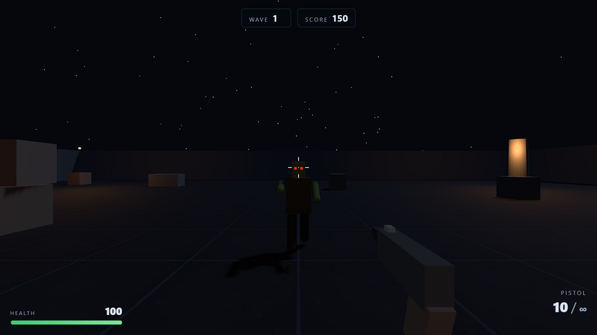

# Gun Game

Game bắn súng góc nhìn thứ nhất (FPS) sinh tồn zombie trong một đấu trường đêm 60×60 m, viết bằng **Three.js + Vite** (ES modules thuần, không framework). Sống sót qua từng đợt wave ngày càng đông, săn headshot để ghi điểm và phá kỷ lục của chính mình.



## Cách chạy

Cần Node.js đã cài sẵn trên máy.

```bash
# 1. Cài phụ thuộc
npm install

# 2. Chạy máy dev (cổng mặc định 5173)
npm run dev
```

Mở **http://localhost:5173** trong trình duyệt (vì cấu hình `host: true`, máy khác trong LAN cũng truy cập được qua IP của bạn).

Hoặc chạy bản build production:

```bash
npm run build     # xuất bản build vào dist/
npm run preview   # phục vụ dist/ tại http://localhost:4173
```

## Điều khiển

| Phím / thao tác | Hành động |
|---|---|
| `W` `A` `S` `D` | Di chuyển |
| `Shift` (trái/phải) | Chạy nhanh (×1.6 tốc độ đi bộ) |
| `Space` | Nhảy |
| Chuột | Ngắm (pointer lock) |
| Chuột trái | Bắn |
| `R` | Nạp đạn |
| `1` `2` `3` hoặc con lăn chuột | Đổi súng |
| `Esc` (hoặc `P`) | Tạm dừng / tiếp tục |

## Tính năng

- **3 loại súng** với cơ chế riêng: lục-cigaret bắn từng viên (25 sát thương, đạn dự trữ vô hạn), shotgun bắn 8 viên đạn ghém mỗi phát, súng trường bắn tự động 600 phát/phút. Đều có giật, độ tản đạn, thời gian nạp đạn và đèn nháy đầu nòng riêng.
- **3 loại zombie**: Walker (100 HP, chậm, 15 sát thương), Runner (60 HP, nhanh, xuất hiện từ wave 2), Brute (400 HP, trâu bò, xuất hiện từ wave 4). Mỗi loại có model, màu da và tốc độ riêng.
- **Hệ thống wave**: wave *n* có `5 + n×3` zombie, xuất hiện rải đều mỗi 0.8–1.5 s; quét sạch wave sẽ có 10 giây nghỉ rồi wave tiếp theo bắt đầu.
- **Pickups**: zombie chết có 18% rơi vật phẩm — 70% là hộp đạn (+1 băng đạn cho súng đang cầm), 30% là blood bag (+40 HP, tối đa 100).
- **Headshot**: bắn trúng đầu nhân đôi sát thương (×2) và nhân 1.5 điểm thưởng.
- **High score**: điểm cao nhất được lưu tự động vào `localStorage` (kèm thiết lập chuột, âm lượng, ngôn ngữ).
- **Song ngữ EN/VI**: đổi tiếng Anh / tiếng Việt ngay trong màn Settings (cùng với độ nhạy chuột 0.5–3.0 và âm lượng 0–1).

## Cấu trúc source

```
src/
├── core/        # Nền tảng: engine.js (renderer/scene/camera), input.js (phím + chuột + pointer lock),
│                # audio.js, settings.js (localStorage), i18n.js (EN/VI), debug.js (window.__game)
├── world/       # Môi trường: level.js (sân 60×60 m, tường, vật cản + collider XZ),
│                # atmosphere.js (trời đêm, sương mù, đèn nhấp nháy)
├── player/      # Người chơi: controller.js (di chuyển/nhảy/va chạm), weapons.js (3 súng, recoil, viewmodel)
├── zombies/     # Kẻ địch: zombie.js (model + AI đuổi/ tấn công + animation chết), waves.js (điều phối wave)
├── systems/     # Gameplay: combat.js (hitscan + tường chặn đạn), particles.js, pickups.js,
│                # gamestate.js (state machine, điểm, high score, bus sự kiện chung)
├── ui/          # Giao diện: hud.js (máu/đạn/điểm/kill feed), menus.js (menu, pause, settings, game over)
└── main.js      # Bootstrap + vòng lặp game + nối dây mọi module qua bus
```
